# sfGFP + 50 bp DNA spring: cryo-EM of the 12-11-2026 screening session (progress report)

*Status as of 2026-11-14 afternoon. Written as a narrative: each section says **what was run**, **what came out**,
and **why the next step was chosen**. Every number comes from a file in `results/` or from the CryoSPARC
project **P6** (`/n/netscratch/hekstra_lab/Lab/ian_poon/cryosparc_projects/CS-cs-sfgfp-chimera-screening/`); job
UIDs are given so each step can be opened in the CryoSPARC GUI. Plan: `~/.claude/plans/i-want-you-to-valiant-ullman.md`.
Data locations and purge dates: `DATA.md`.*

## Contents
- [0. Bottom line so far](#0-bottom-line-so-far)
- [1. Data, acquisition parameters and gain (G0)](#1-data-acquisition-parameters-and-gain-g0)
- [2. Pilot on one grid square (P0)](#2-pilot-on-one-grid-square-p0)
- [3. What the pilot showed: sfGFP dots, DNA threads, crowding](#3-what-the-pilot-showed-sfgfp-dots-dna-threads-crowding)
- [4. Choosing a picking strategy (judge panel)](#4-choosing-a-picking-strategy-judge-panel)
- [5. Hand labelling attempt and the visual guide](#5-hand-labelling-attempt-and-the-visual-guide)
- [6. Full-dataset preprocessing (W1)](#6-full-dataset-preprocessing-w1)
- [7. Picking, filtering and round-1 2D (W2)](#7-picking-filtering-and-round-1-2d-w2)
- [8. Reading the 2D classes: blind consensus, and why there are no circular chimeras](#8-reading-the-2d-classes-blind-consensus-and-why-there-are-no-circular-chimeras)
- [9. Is the dot at the rod end a real attachment? (co-localisation test + adversarial review)](#9-is-the-dot-at-the-rod-end-a-real-attachment-co-localisation-test--adversarial-review)
- [10. Free-DNA positive control through the Fig S6 core (W3)](#10-free-dna-positive-control-through-the-fig-s6-core-w3)
- [11. Why I asked for the original gel, and what it showed](#11-why-i-asked-for-the-original-gel-and-what-it-showed)
- [12. Reconciling gel and EM (hypothesis panel)](#12-reconciling-gel-and-em-hypothesis-panel)
- [13. What is running now and what comes next](#13-what-is-running-now-and-what-comes-next)
- [14. Deviations from the plan / paper workflow](#14-deviations-from-the-plan--paper-workflow)
- [15. Mistakes I made and corrected](#15-mistakes-i-made-and-corrected)
- [Appendix: job table, compute, files](#appendix-job-table-compute-files)

---

## 0. Bottom line so far

| Question | Answer | Confidence | Section |
|---|---|---|---|
| Are closed DNA-loop chimeras (≈9 nm ring, sfGFP on the rim) on the grid? | **No intact, face-on or tilted rings** at anything near the abundance the gel implies; none of 304 2D classes from 1.14 M particles shows an enclosed hole | High for open rings (unanimous blind review; simulated rings are obvious in this ice). Edge-on rings: no ring-specific pair spacing and sub-duplex link density (A5, §13a), but a minority of ≤ ~12–32 % in the "two dots + thread" classes cannot be excluded. Not yet tested: dot-centred rings clipped by the 2D window into "dot + hook" shapes (§8) | §8, §12, §13 |
| What *is* on the grid? | Free sfGFP (dense, crowded: ~330 per micrograph), straight DNA rods (~140 Å, some with the 34 Å B-DNA repeat), many "dot at one end of a rod" particles, ice/junk | High | §3, §8 |
| Are the dot-on-rod-end particles covalent sfGFP–DNA conjugates? | **Not shown, not excluded.** Picking and 2D select dot-at-end configurations, so there is no selection-free test in these data | Wording set by the review judge after three lens-specific skeptics; one of them judged my original verdict did not survive (`results/rod_end_coloc_review.json`) | §9 |
| Does the pipeline work on something rigid? | Yes: the "free DNA" control reconstructs to **7.9 Å** (RELION phase-randomised, tight mask; 8.7 Å loose), cFAR 0.27 | High | §10 |
| Does the gel contradict the EM? | The gel shows a real cDNA-dependent band (≈20–28 % of sfGFP net); the EM rules out *intact* rings at that abundance, so the band is most likely **incomplete/yielded loops**, or rings that open on the grid, or few closed loops | Hypotheses ranked, discriminating tests running | §11–§13 |

---

## 1. Data, acquisition parameters and gain (G0)

**What was run.** The 1.42 TB EPU session was pulled from the facility rsync server. Compute nodes cannot reach it
(TCP probe job 60306535 timed out) and login nodes kill a user's processes on logout, so the transfer ran **on
holylogin05** inside an ssh session held open by a small `test` job (`slurm/00_download.sbatch`). The 311 GB of
per-movie EPU preview `.mrc` files were skipped (your call). All **28,370 files (1.108 TB) arrived byte-exact**
against the listing, then the raw tree was made read-only.

**What came out** (`results/g0_acquisition.json`, read from the EPU xml and the movies themselves):

| | |
|---|---|
| Microscope / detector | Glacios **200 kV**, Falcon 4i behind an energy filter (10 eV slit), Cs 2.7 mm |
| Magnification / pixel | 165,000× nominal, **0.71 Å/px** |
| Movies | **9,019** in 20 grid squares, 50 fractions, 2.94 s, LZW TIFF 4096², **uint8 raw counts** |
| Dose | 39.72 e/Ų used (your vacuum calibration); 28.2 e/Ų is what is *detected through the sample*, 71 %: consistent with ice + filter loss |

**Decision: the gain.** The movies are raw counts, so the EPU EER gain reference has to be applied, and its
orientation is not documented. Rather than guess, I correlated the summed flat field of 12 real movies with all
8 orientations of the gain: **as-is won (r = +0.070 vs ≤ 0.030 for the other seven)**. The correlation is weak in
absolute terms (only ~170 counts/px summed), but the margin is 2.3×. After motion correction the averaged power
spectrum (24 micrographs) shows no fixed-pattern cross at mid/high frequency, where a wrong gain orientation would
show as sharp axis lines. In the third panel the row through the centre rises only at the lowest frequencies, which
is the specimen's own low-frequency signal that the off-axis row never samples:

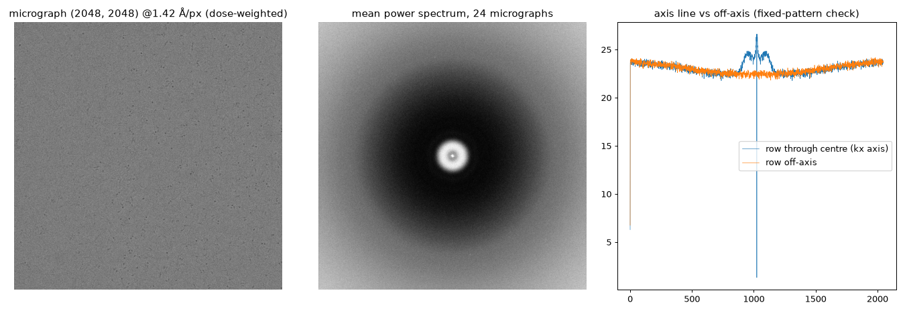

---

## 2. Pilot on one grid square (P0)

**Why a pilot.** The plan required measuring per-movie cost and the sample's appearance on a small subset (free
MIG GPU slices) before committing paid GPU time to 9,019 movies.

**What was run** (workspace W8 "P0", all free lane): import J2 (412 movies, gain unflipped, EPU beam shifts) →
patch motion J3 (300 movies, Fourier-crop ½ → **1.42 Å/px**) → patch CTF J4 → blob picker J5 (80–140 Å
circles + ellipses) → extract J6 (256 px → 128 px, 2.84 Å/px) → 2D J7 (100 classes, 12 Å, marginalised poses).

**Results.**
- **Speed:** patch motion **3.7 s/movie** on a MIG slice. This set the lane choice for the full set (§6).
- **Micrograph quality is good:** CTF fit median **3.6 Å** (p90 5.3 Å), defocus 0.8–2.1 µm (p10–p90),
  relative ice thickness 1.06 (thin).
- **Picks:** 165,638 picks (552/micrograph); 2D kept 126,623.

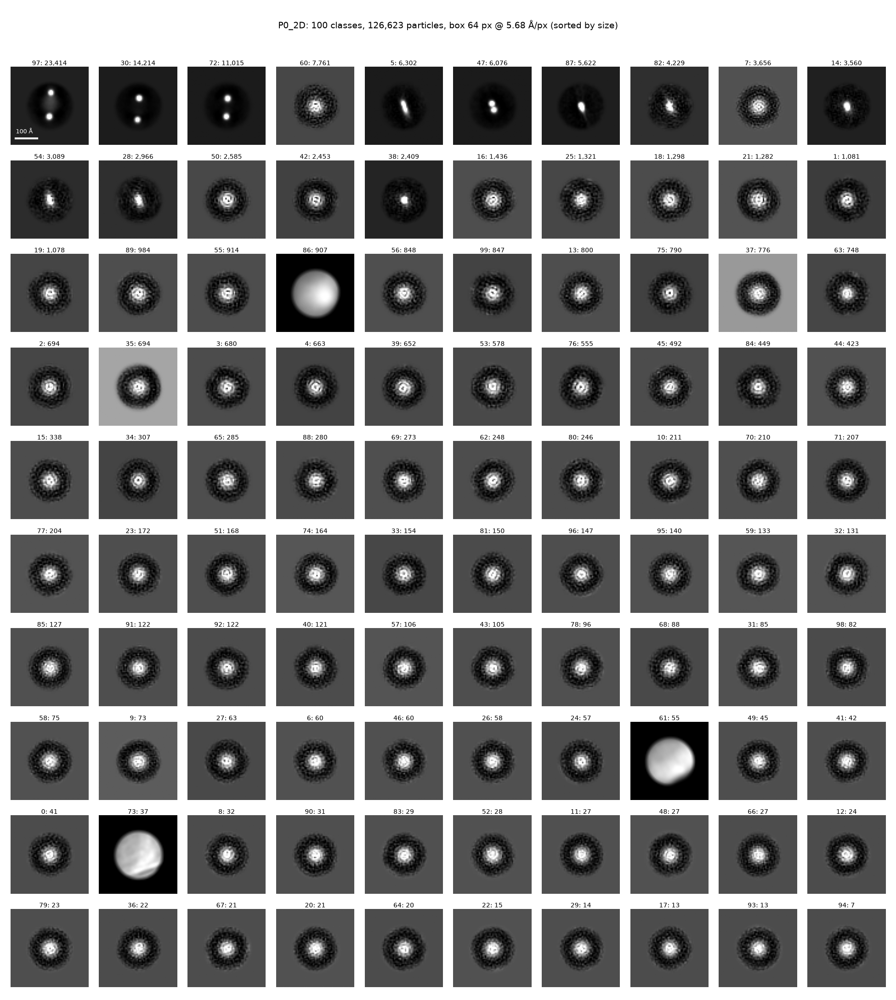

*(All 2D montages show the class averages as CryoSPARC writes them, Fourier-cropped to 64 px at the 2D resolution
limit (5.68 Å/px here); the particles themselves are 128 px at 2.84 Å/px.)*

The pilot 2D looked unlike the expected chimera:
- **38 %: "two sharp dots ~120 Å apart"** (classes 97/30/72)
- **27 %: short rods or a dot with a tail**
- the rest featureless noise
- **no ring class.**

---

## 3. What the pilot showed: sfGFP dots, DNA threads, crowding

**Why look at raw micrographs.** Before redesigning picking I wanted to know *what physical objects* the classes
were made of. I coloured picks by 2D population on a low-pass micrograph and pulled raw crops:

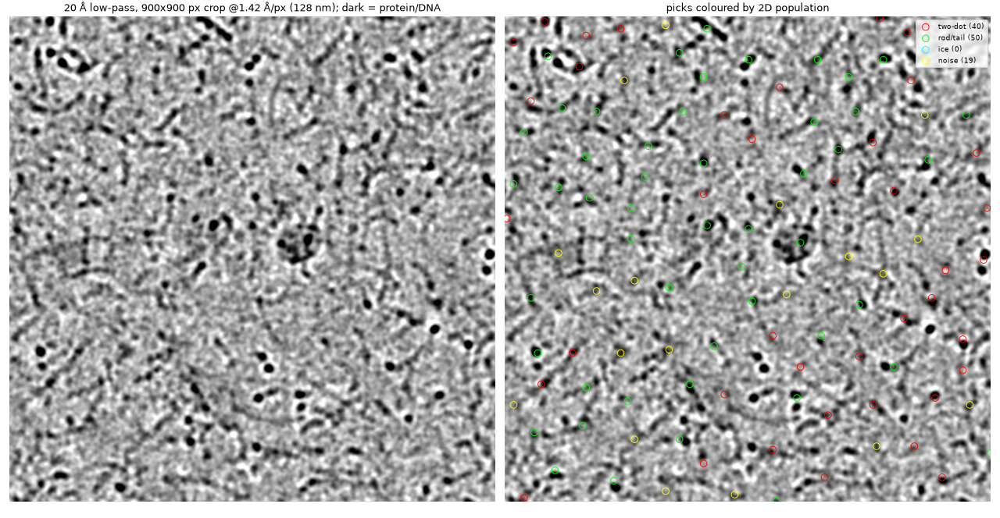
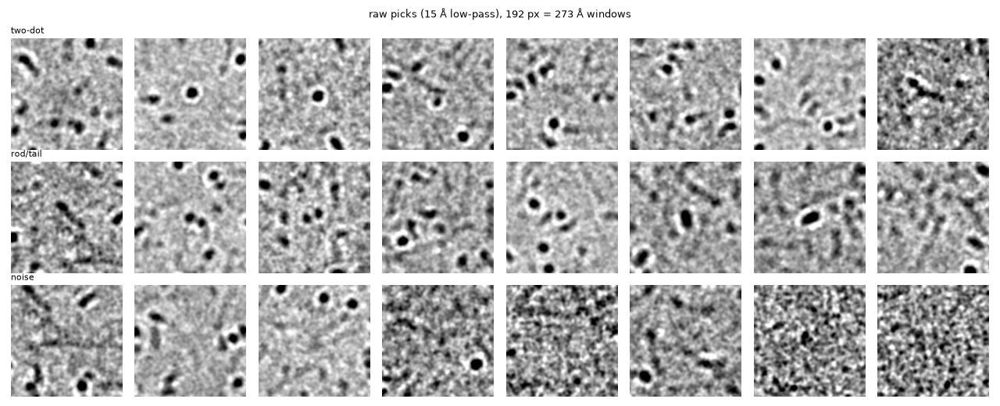

At 12 Å low-pass the ice holds two populations:
- **many compact, very dark ~3 nm dots with bright Fresnel halos**
- **thin wormlike ~2 nm threads 10–20 nm long**

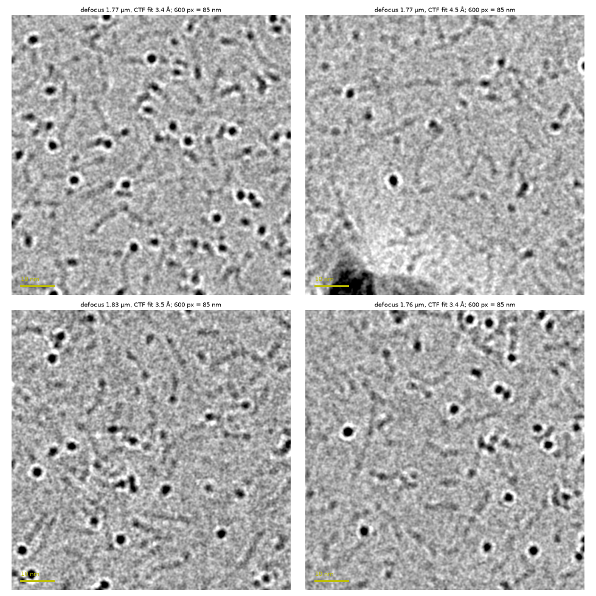

**Are the dots sfGFP?** They looked darker than I expected for a 27 kDa protein next to DNA, so I tested it
quantitatively. I projected the L6_loop50 model's sfGFP and its DNA with this dataset's CTF (200 kV, 1.8 µm,
12 Å low-pass): **sfGFP peaks 1.4–2.2× darker than the DNA arc.** So the dark dots are what sfGFP should look
like, and the threads are DNA. The "two dots" classes were picks landing *between* neighbouring sfGFPs.

**Spatial statistics** (`scripts/12_dot_spatial_stats.py`, `results/G0_spatial.json`; CPU only; nulls built only
from real coordinates):
- **Dot density:** 94,870 dots in 300 micrographs, median **331 per micrograph (~4,500/µm²)**. Median
  nearest-neighbour distance is 65 Å, which is very crowded.
- **No preferred 120 Å pairing:** pairs at 110–130 Å occur at **0.985×** the local-density (jitter) null. The
  pilot's two-dot classes are therefore chance neighbours, not dumbbells.
- **Touching pairs.** In a 30–40 Å window there is an excess of 1.3× the jitter null, about 4 % of dots. That
  window was chosen **after** seeing the data. The pre-registered 35–50 Å window gives only 1.08× (pairs) and
  1.17× (nearest neighbour) against the jitter null, 2–3 % of dots. Touching pairs are possibly real but modest.
  A later analysis (A5, §13a) found the short-range (45–60 Å) pair excess grows with defocus, so part of it may
  be a detector/CTF artefact.
- **Automatic "two arms closing" loop candidates:** **0.38 % of dots vs 0.22 %** at random background spots,
  which is barely above background.

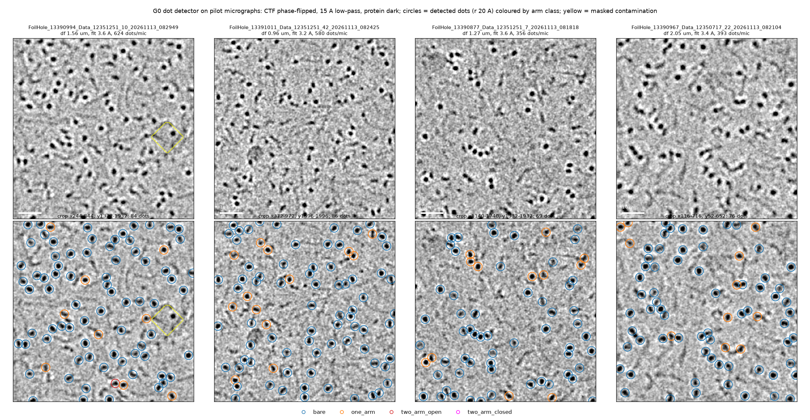
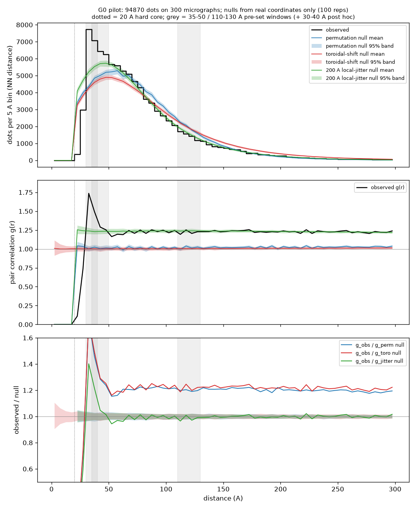

---

## 4. Choosing a picking strategy (judge panel)

**Why a panel.** The pilot showed the blob picker was dominated by the sfGFP dots and their chance neighbours.
How to pick a ~9 nm ring out of a crowded mixture decides whether the project can work at all, so I asked three
independent planners for different strategies (paper-faithful / target-the-chimera / compute-and-risk) and had a
judge score them.

**Decision taken: "anchor-and-gate".**
- **Two pick streams.** sfGFP-sized dots ("anchors", one per chimera, and the census denominator) and DNA-sized
  elongated objects ("rods").
- **The paper's Fig S6 core is kept:** 2× 2D, ab initio + 3 decoys from this dataset's junk, hetero/NU cycles,
  PCA class_3D, Topaz.
- **A hard gate before any 3D.** Measure the ring rate first. **Gate G2** (after round-1/round-2 2D): proceed to
  chimera 3D only if there are ≥ 2 distinct ring classes of consistent diameter (± 5 Å), each with one dot on the
  rim and ≥ 10k particles in total (≥ 30k for a 6–9 Å target). Otherwise the deliverable becomes a census + 2D
  gallery + free-DNA control map instead of a forced 3D chimera map. You approved this fallback ("if fewer than
  ~0.3 loops per micrograph").

---

## 5. Hand labelling attempt and the visual guide

**Why.** The judge wanted human ground truth to measure the ring rate and train Topaz. I built a local
click-to-label page (`labeler/`, served from your desktop; publishing to claude.ai was blocked as external
sharing, correctly). It held 40 Topaz-denoised micrographs stratified over 5 grid squares and 8 defocus settings.

**What happened.** You reported you could not tell DNA from protein or find obvious loops. I took that as data, not
a failure. To make the task concrete I built a **contrast-calibrated guide**: the L6_loop50 model projected with
this dataset's CTF, scaled so its sfGFP matches the measured darkness of the real dots, and pasted onto real ice.
Real crops of the detector's candidates are alongside.

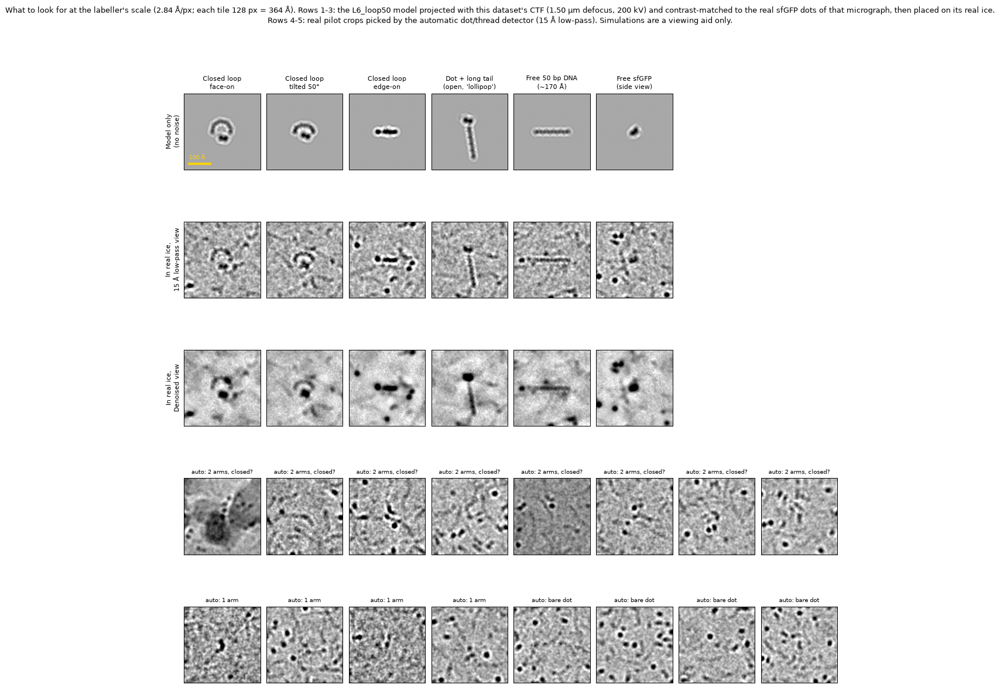

The guide shows:
- rings and 170 Å DNA bars **should be obvious** in this ice
- the real micrographs mostly show compact dots and fainter, shorter, wavier threads

This was the first strong hint that intact rings are rare. No labels were placed before the desktop session ended,
so the analysis below does not depend on hand labels. (Image facts explained at the time: 1 screen px = 2.84 Å, a
micrograph is 291 nm wide, "defocus setting" is in micrometres; lower defocus is better for seeing 20 Å-wide DNA.)

---

## 6. Full-dataset preprocessing (W1)

**What was run.**
- **Import:** J8, all 9,019 movies, headers read.
- **Split:** J9, two halves.
- **Patch motion:** J10 + J12, one per free MIG slice, 263 and 270 min. 9,018 micrographs; 1 movie produced no
  micrograph.
- **Patch CTF:** J15 + J16, 181 min each. 5 micrographs failed (J16 "incomplete"), leaving **9,013** for curation.

**Decision: free lane instead of the paid A100 lane for motion.** Your instruction was "paid lane for heavy steps".
The pilot measured 3.7 s/movie on a free slice, about 4.6 h per half on two slices. The paid `gpu` partition
quoted a **~13 h queue** (fairshare 0.24). Free was faster *and* cheaper, so I deviated and told you. **Paid
GPU-hours used to date: 0.**

**Curation** (`selections/S0_exposures.json`; scripted instead of the interactive job):
- CTF fit ≤ 6 Å
- astigmatism ≤ 1000 Å
- defocus 0.5–2.8 µm
- relative ice ≤ 1.20

This kept **8,036 of 9,013** micrographs (89 %), as External J17.

---

## 7. Picking, filtering and round-1 2D (W2)

**What was run.**

| Stream | Picker | Picks | Kept after power filter | Extracted | 2D (200 classes, 12 Å) |
|---|---|---|---|---|---|
| rods | J18 ellipse 20–180 Å, min dist 4×20 Å | 1,583,293 | 791,644 (J22) | J23: 256 → 128 px, **606,539** extracted | **J27**: 546,701 particles |
| anchors | J19 circle 30–50 Å | 6,358,457 | 3,179,227 (J24) | random 25 % of micrographs (2,009): 791,157 (J25) → J26: 192 → 96 px, **661,162** extracted | **J28**: 603,273 particles |

Losses between steps are by design:
- **At extraction:** picks whose box would cross the micrograph edge are dropped. A 256 px box at 1.42 Å/px is
  large relative to a 2048 px micrograph.
- **In 2D:** `class2D_remove_duplicate_particles` removes picks closer than the minimum distance (80 Å for rods,
  default for anchors) after re-centring.

The 2D windows matter for §8: **200 Å** inner window for rods (100 Å radius) and **220 Å** for anchors (110 Å
radius).

**Why a local-power filter.** The pilot showed pick NCC does *not* separate real objects from noise (median 0.385
vs 0.375). Local power does (684 vs 431). The first version used the pilot's absolute thresholds and kept only
**1.3 %** of rod picks: the new picker's power scale is ~2.5× lower. I caught it, retired that set (J20/J21), and
switched to a per-stream rule: keep the top 50 % by power within each 0.25 µm defocus bin
(`selections/pick_power_filter_v2.json`).

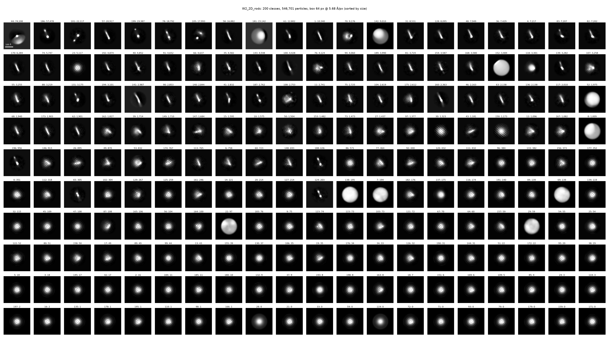
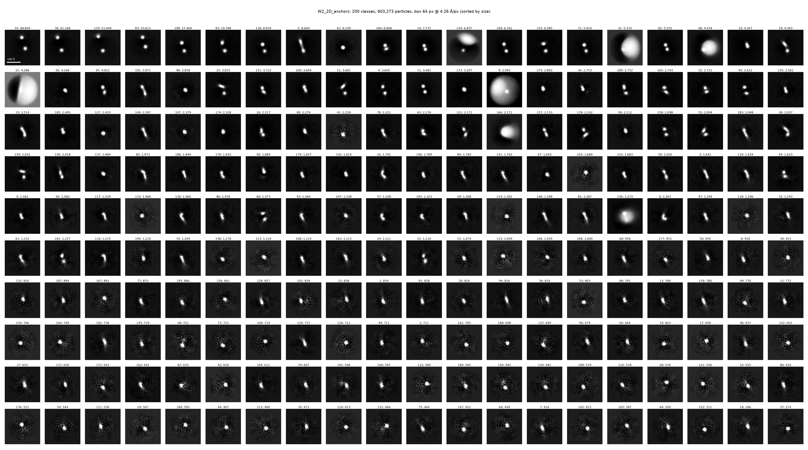

Large-tile review sheets: `figures/2d/review/W2_2D_rods_p01–03.png` and `W2_2D_anchors_p01–05.png`. The two
largest pages:

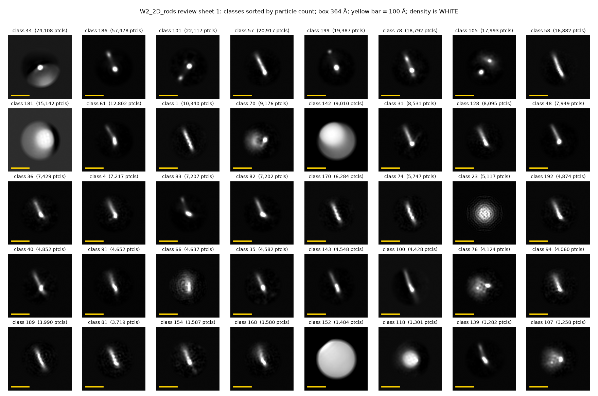
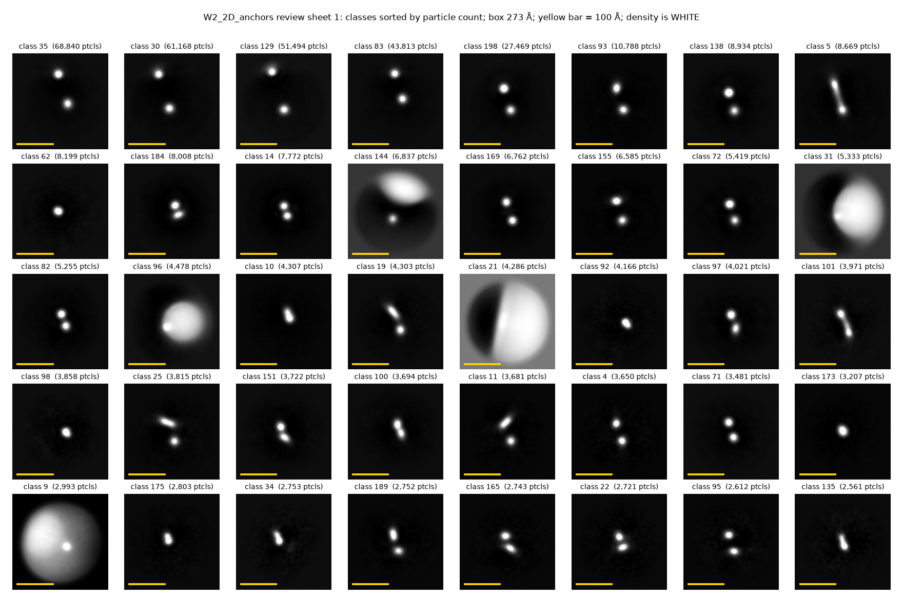

---

## 8. Reading the 2D classes: blind consensus, and why there are no circular chimeras

**Why not just my reading.** My first read was "rods with a dot at one end, no rings". That reading drives the
whole project, and I could be anchored on my own hypothesis.

**How the consensus was reached.**
1. **Objective shape numbers per class** (`scripts/41_class2d_morphology.py`, `results/class2d_morph_*.csv`):
   length, width, dot brightness, number of blobs, and **whether the density encloses a hole ≥ 30 Å**.
2. **Blind review.** Three independent reviewers labelled **all 304 classes** (104 rod + 200 anchor; every class
   with ≥ 270 particles) from the sheets and the shape table. They were given only neutral category definitions,
   not my reading. Categories: closed_loop, dot_long_rod, dot_short_rod, rod_no_dot, dot_pair_thread, dot_pair,
   single_dot, dot_cluster, ice_contaminant, noise_junk, unclear.
3. **Majority vote in code.** 2 of 3 decides; a three-way split becomes "unclear". 81 classes had some
   disagreement; none was unlabelled.
4. **Skeptics** were sent against every closed-loop vote and against the conjugate claim.

Results are in `results/class2d_blind_review_W2.json`, with per-class labels in `results/class2d_labels_*.csv`.

**Particle-weighted census of picked objects** (a census of picks, not molar ratios; each stream's picker biases it):

| Rod stream (541,047 in reviewed classes) | | Anchor stream (603,273) | |
|---|---|---|---|
| dot at one end of a ≥100 Å rod | 26.1 % | two separate dots, no connection | 61.9 % |
| ice / contamination | 20.0 % | single dot (free sfGFP) | 17.8 % |
| rod, no dot (free DNA) | 19.0 % | dot + short (<100 Å) rod | 12.3 % |
| two dots + faint thread | 15.5 % | ice | 4.5 % |
| two dots, unconnected | 6.9 % | two dots + thread | 3.5 % |
| noise / unclear / dot + short rod | 12.4 % | | |

**Why I conclude there are no intact, open circular chimeras on the grid (and what is not yet excluded):**
1. **No closed loops by anyone.** All three blind reviewers, working independently, found **no ring or enclosed
   hole in any of 304 classes**, and none cast a closed_loop vote, so no closed-loop call needed a skeptic.
   - They did note borderline shapes. Small "bent or hooked but open" anchor classes 16, 85 and 130 and small
     hooks in anchors 6 and 116 were judged too small (< ~60 Å) and open to be a loop.
   - Rod classes 70, 76, 107, 108 and 39 show "a dot at the edge of a diffuse ~70 Å haze" with no hole, and were
     labelled unclear.
2. **The objective hole detector agrees,** with a caveat. `hole = 0` for every class, but the detector (enclosed
   background ≥ 30 Å at z > 2) has **not been validated on a positive control**, such as projected L6 rings at
   12 Å in the same window, so its sensitivity is unknown.
3. **Rings would be easy to see in the micrographs.** Simulated L6 rings are obvious in this exact ice and CTF (§5).
   DNA contrast is high enough that some free rods show the 34 Å helical repeat.
   - **Window caveat:** a ~106 Å ring centred on the dot (as in the anchor stream) puts its far rim ~106–110 Å
     from the box centre. That is right at the anchor window's 110 Å radius (the rod window is 100 Å).
   - So a dot-centred ring could average into a **dot + curved hook** rather than a closed ring. The few hook
     classes in point 1 are therefore not fully explained yet.
4. **Abundance.** The anchor stream centres on sfGFP dots, which every chimera carries. The gel implies about
   20–28 % of sfGFP in the shifted species, i.e. ~65–90 per micrograph (judge estimate in
   `results/gel_em_reconciliation.json`). Over the **2,009 micrographs** of the anchor subset that is
   **~0.13–0.18 M** expected rings. Even 1 % recovery (~1.3–1.8k particles) would exceed the 270-particle class
   floor and form a class.
5. **What could still hide rings:**
   - a near-exclusive **edge-on** orientation (a ring seen edge-on is a ≤ 110 Å bar)
   - rings clipped by the window into hooks (point 3)
   - rings that **open on the grid**

   These are being tested by A5, A1 (400 Å window) and A7 (§13). A wider-window re-classification of the anchor
   hook classes is added to the to-do list.

---

## 9. Is the dot at the rod end a real attachment? (co-localisation test + adversarial review)

**Why this mattered.** If the dot-on-rod-end particles are covalent sfGFP–DNA, the reaction made open conjugates
("lollipops"). If they are chance overlaps in crowded ice, they say nothing. The skeptics of §8 refuted my
lollipop reading 3/3. They pointed out that chance neighbours already make **sharp** two-object classes here (the
62 % dot pairs), and that the power filter favours overlaps.

**What was run** (`scripts/17_rod_end_colocalisation.py`, `results/rod_end_coloc.json`; CPU only):
1. **Conventions.** The 2D pose/shift convention and micrograph orientation were determined **without using dots**,
   by correlating particles with their class averages: r = 0.215 vs 0.084 for the runner-up, no axis flips,
   extracted images contrast-inverted.
2. **Rods and dots.** Every rod of the rod-like classes (241,055 after a valid-area check and duplicate removal)
   was mapped into micrograph coordinates. The validated dot detector was run on the 8,019 curated micrographs that
   contain these rods (2.16 M dots); the other 17 of 8,036 curated micrographs have no rod-like particles.
3. **Test.** For each rod, is a dot within d of a rod end, compared with nulls that rotate or shift the same real
   rods?

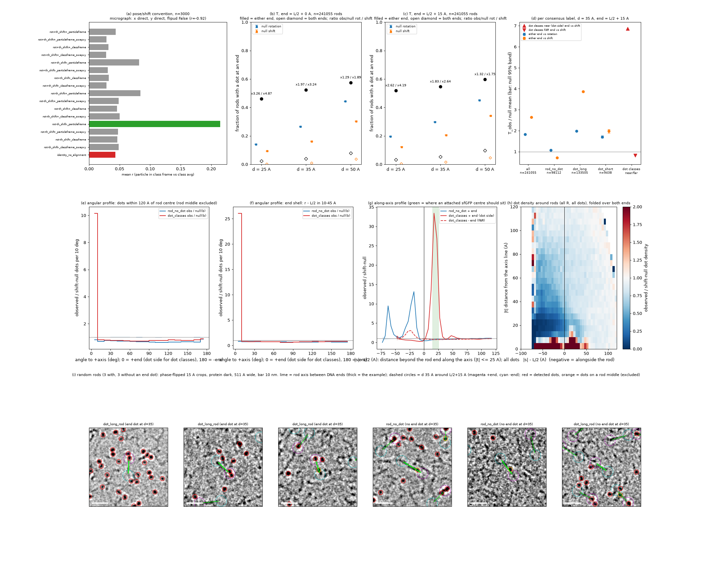

**Results and how they were read.**
- **The end enrichment is a selection artefact.** Overall it looks strong: **1.3–4.9×** for a dot at either end
  (d = 25–50 Å, rotation and shift nulls), and up to ~9× for the near end alone. But it comes entirely from the end
  the picker and 2D aligned on, which was selected *because* a dot was there.
- **Adversarial review** (3 lens-specific skeptics + judge, `results/rod_end_coloc_review.json`) corrected the
  first verdict in several ways:
  - Most "free DNA" class averages carry a **one-ended blob**. **27 % of rod_no_dot particles have a detected dot
    10–32 Å inside one end** (4 % at the other end); the along-axis dot density there is 13× the shift null; the
    class-average blobs peak 18–31 Å inside the end. I had first misread these as helical-repeat false peaks; they
    are one-sided, so they are not.
  - The ends I had called "selection-free" sit inside the 200 Å 2D window, which itself depletes dots.
  - The far-end 0.43× rotation-null ratio is an artefact: the rotated end swept over the real near-end dot.
- **Final wording:** covalent end attachment is **NOT SHOWN, and these data cannot rule it out.** Only a
  selection-free design or a bench measurement can settle it.

---

## 10. Free-DNA positive control through the Fig S6 core (W3)

**Why.** This is the agreed fallback deliverable and the paper's workflow applied to a rigid particle we know is
present. It tests whether the pipeline, data and CTF support a real 3D reconstruction.

**What was run** (`scripts/31_duplex_control.py`, workspace W3, all free lane):
1. **Target ab initio:** 103,028 "rod, no dot" particles → J34.
2. **Three decoy ab initios** from this dataset's own junk (as in the paper): noise J35, ice J36, unconnected dot
   pairs J37.
3. **Hetero refinement** J38 of the pooled 283,586 particles against all four volumes (hard classification). The
   duplex class kept 64,036; the decoys took 54,847 / 100,397 / 64,306.
4. **NU refinement** J39.
5. **Validation** J40, **orientation diagnostics** J41, **local resolution** J42.
6. **RELION 3.1 post-processing** with phase randomisation (`scripts/32_relion_postprocess.sh`).

| Measure | Value |
|---|---|
| CryoSPARC GSFSC 0.143: no mask / spherical / tight | 9.7 / 8.9 / **7.8 Å** |
| RELION phase-randomised: CryoSPARC mask / loose mask | **7.9 / 8.7 Å** |
| cFAR / SCF* | **0.27 / 0.94** (moderate anisotropy, good sampling) |

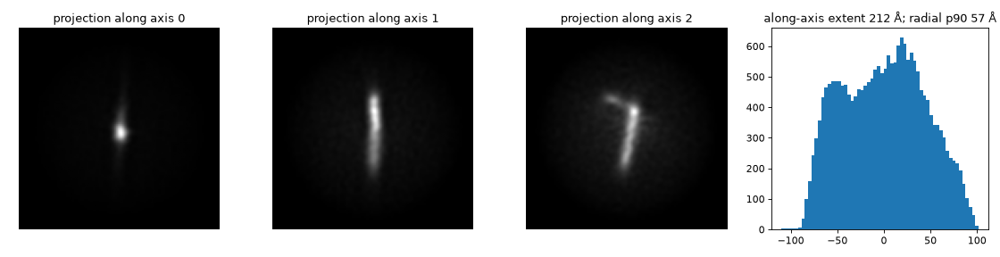
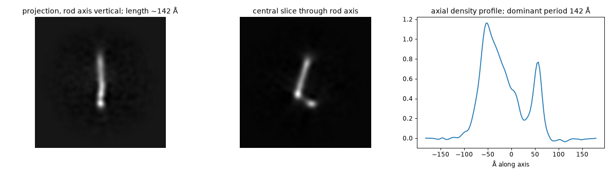

**Reading.** This is a genuine ~8–9 Å map, but **not bare DNA**. It is a rod body about 110 Å long with a compact
lobe bent off one end.

The lengths in the figures mean different things:
- **~142 Å** in the NU check figure is the *total* projected length including the lobe. Its "dominant period
  142 Å" is just that extent: no 34 Å repeat stands out.
- **212 Å** in the ab-initio figure is the extent of the top-0.7 % voxels of an unmasked ab-initio volume, which
  includes noise. That fits the one-ended blob seen in those classes (§9). It could be an attached sfGFP, or a
consistently aligned neighbour. Proper ChimeraX figures are still to be made: the first renders were badly
framed, and the lobe volume is to be compared with sfGFP's ~33,000 ų.

---

## 11. Why I asked for the original gel, and what it showed

**Why I asked.** After §9 the EM could neither show nor exclude conjugation, and §8 showed no rings. The missing
independent fact was the **solution-state product distribution of this exact reaction**. A gel is the cheapest
data that can tell "the reaction made no loops" from "loops form in solution but are invisible or destroyed on the
grid".

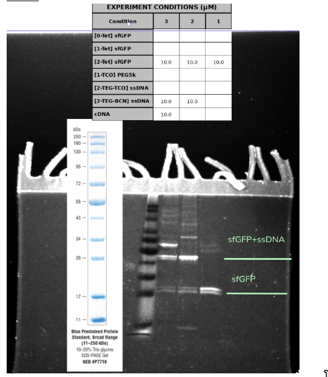

**What the gel is.** A fluorescent (in-gel GFP) 10–20 % Tris-glycine SDS-PAGE. All lanes have 10 µM 2-Tet sfGFP:
- **Lane 1:** sfGFP alone.
- **Lane 2:** + 10 µM 2-TEG-**BCN** ssDNA. (The chemistry is BCN, not the sTCO used in the MD builds.)
- **Lane 3:** + ssDNA + 10 µM cDNA.

You told me two things: the cDNA-dependent upward shift does **not** occur with 1-Tet sfGFP, and the grid sample
was made by clicking first and adding cDNA later.

**Rough densitometry** (low-resolution composite; lane 1 shows how much signal the band windows pick up from
background and neighbouring-band bleed):

| Lane | ~30 kDa (shifted) | ~26 kDa (sfGFP + ssDNA) | ~18 kDa (free sfGFP) |
|---|---|---|---|
| 1 sfGFP only | 20 % (baseline) | 12 % (baseline) | 68 % |
| 2 + ssDNA | 16 % | **59 %** | 26 % |
| 3 + ssDNA + cDNA | **40 %** | 44 % | 17 % |

This table folds the minor bands into the three windows: a ~35 kDa band (~10 % in lane 2) and > 40 kDa high-MW
bands (13–18 %). A second estimate with local background subtraction (expert 2 in
`results/gel_em_reconciliation.json`) gives lane 3 as 31 % (~30 kDa), 33 % (~26 kDa) and 11 % (free).

**What I learnt.**
1. **The reaction did not fail.** Measured as depletion of the free-sfGFP band relative to lane 1
   (68 % → 26 % → 17 %), **about 60–75 % of sfGFP is conjugated** (lane 2 ≈ 62 %, lane 3 ≈ 75 %).
2. **Adding cDNA creates a distinct new ~30 kDa species**, about 20–28 % of sfGFP net of the lane-1 baseline.
   - **Caveat (from the judge):** the 1-Tet result comes from a separate experiment, not this gel, and not at a
     matched conjugation yield.
   - Even if it holds, it shows the band needs a **protein-closed loop**. It does not show the loop carries a
     **complete 50 bp duplex**.
3. **So the EM null is a real puzzle**, not just a failed reaction.

---

## 12. Reconciling gel and EM (hypothesis panel)

**Why a panel.** The tension is subtle (physics of strained loops, gel mobility of conjugates, what cryo-EM can and
cannot see), and I had a favourite hypothesis that I did not want to over-weight. Three independent experts
reasoned from different angles: loop physics, gel interpretation, EM visibility. A judge ranked the merged
hypotheses (`results/gel_em_reconciliation.json`).

| # | Explanation | Posterior |
|---|---|---|
| 1 | **Loops formed but incomplete or yielded.** Partial duplex closed by invisible ssDNA, or one kink folding the arc into a narrow V. Looks like a dot + short rod, no hole | 0.30 |
| 2 | **Few loops on the grid.** Dot-on-rod = linear mono-adducts, e.g. cDNA pairing before the second click | 0.29 |
| 3 | ss loops close but cDNA cannot fully hybridise | 0.14 |
| 4 | Rings exist in solution but open or deform at the air–water interface | 0.10 |
| 5 | Intact rings seen only edge-on | 0.06 |
| 6 | Intermolecular sfGFP–DNA–sfGFP dumbbells / short chains (accounts for the high-MW gel bands and a far-end bump in class 78; predicts ≥ 45 kDa bands, not the ~30 kDa one) | 0.06 |
| 7 | The ~30 kDa signal is mostly a gel artefact / sfGFP conformer | 0.03 |
| 8 | Intact face-on/tilted rings present but missed by picking and 2D | 0.02 |

**What the panel ruled out:**
- intact open rings at gel-level abundance
- "the picker missed them"
- my own "shorter attached DNA" argument (those lengths were clipped by the 200 Å window, so the length is not
  evidence yet)

**What your answer changed.** You confirmed the grid sample was **clicked first, cDNA added later**. That removes
hypothesis 2's "hybridise first" mechanism, since the ss loops had the chance to close before any duplex formed.
Its other mechanisms remain: a dead or reduced second tetrazine, or a slow BCN click leaving open mono-adducts.
My reading of the ranking is now roughly **1 > 2 ≈ 3 > 4**. The panel has not re-scored it.

---

## 13. What is running now and what comes next

**Running now (the three EM analyses you chose):**
- **A1: window-free attached-DNA length** (`scripts/34_A1_window_free_rods.py`). 224,312 rods were re-centred
  (90 Å from the dot along the axis for dot-rods; midpoint for free rods; External J43), extracted at a 454 Å
  box without re-applying the 2D shifts (J44), then 2D with a 400 Å window.
  - Attached DNA as long as free rods (~140–150 Å, 4–5 helical repeats) means linear adducts (hypothesis 2/3).
  - A distinct shorter mode means yielded or incomplete loops (hypothesis 1).
- **A5: edge-on ring test.** Is there a narrow 85–110 Å dot-separation excess with a ≥2× duplex-density thread
  (edge-on rings), or only chance pairs?
- **A7: ice-thickness split.** Do thick-ice micrographs (less air–water interface) carry more DNA-attached sfGFP,
  longer DNA or ring-like averages (hypothesis 4)?
- A5 and A7 are each implemented by one agent and checked by an independent skeptic.

### 13a. Results so far (each implemented by one agent, then checked by an independent skeptic; wording below is the verifier's corrected statement)

**A5: edge-on ring test. Hypothesis 5 not supported** (`scripts/43_A5_edge_on_ring_test.py`,
`results/A5_edge_on.json`):
- **No ring-specific pair spacing.** Across 1.50 M eligible dot centres (2.16 M detected), the shift-null pair
  correlation is flat at ~1.015–1.026 from 75 to 160 Å, with **no excess at 85–110 Å** (window minus flanks
  −0.001 [−0.004, +0.002]). A ring signal spread over 75–135 Å is limited to **≤ ~5–5.6k pairs**.
- **The rod-stream "two dots + faint thread" classes are mostly not rings.** They sit mostly in the thinnest,
  most crowded ice, and their link carries **0.25–0.64× a single duplex** of density, where an edge-on ring
  predicts ≥ 2×.
- **Caveat:** a class average is a population mean, so a **minority of up to ~12–32 % edge-on rings** with an
  undetectable far rim cannot be excluded.
- **The anchor "two dots + thread" classes** are 42–73 Å dumbbells with no density beyond the first dot, not
  edge-on rings.
- **New flag:** the 45–60 Å short-range pair excess grows with defocus. That suggests a detector/CTF artefact,
  which weakens §3's touching-pair excess.

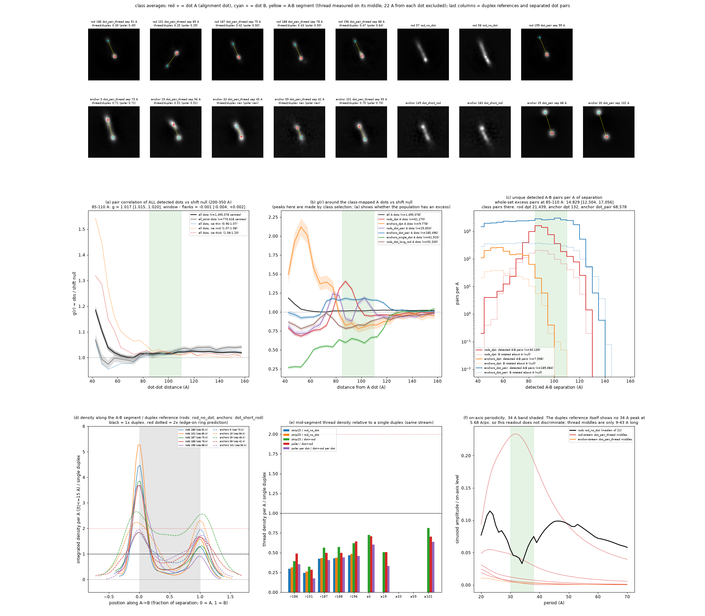

**A7: ice-thickness split. Hypothesis 4 not supported, but the test has little leverage**
(`scripts/44_A7_ice_tertiles.py`, `results/A7_ice_tertiles.json`):
- **No rings in any tertile.** No per-tertile class average in either stream shows a strict hole; three lenient hits
  are 23–32 Å gaps in junk/ice classes.
- **No extra attachment in thick ice.** Dots at rod ends that 2D did not select on stay below chance in every
  tertile, flat with ice after density matching (T3−T1 ratio −0.001 [−0.046, 0.044]). This also holds within each
  shot position.
- **The census changes strongly with ice, but this tracks crowding** (thin ice ~1.8× more dots).
- **Two small effects point weakly toward hypothesis 4:**
  - a dot-on-rod excess of +4.7 points in thick ice, largely offset by +3.7 for free rods
  - the attached-DNA mask length rises 83 → 90 Å, but free rods also rise 3 Å and the median per-class change
    is 0
- **Why leverage is low:** the ice range is narrow (1.05–1.10), and thickness is confounded with CTF fit quality
  (ρ 0.64), acquisition time, and **the third EPU shot position in each foil hole**. That position is thicker, has
  fewer dots, a worse fit and more astigmatism, and supplies 61 % of the thick tertile.

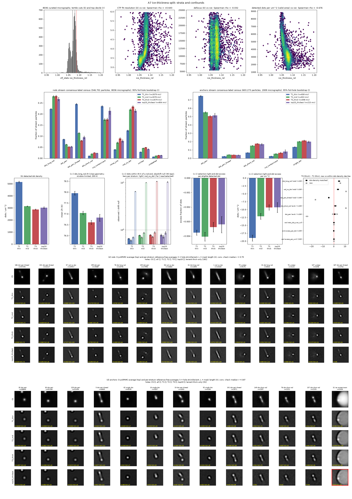

**Net effect on §12:**
- Edge-on rings (hypothesis 5) and air–water-interface opening (hypothesis 4) have no positive support, but
  neither is strongly excluded.
- The leading explanations remain incomplete/yielded loops (1) and linear adducts (2), which **A1 is designed to
  separate**.

**Why these three and not the panel's other proposals** (you chose from A1, A5, A7; the others were not offered or
were deferred):

| Analysis | Status | Reason |
|---|---|---|
| A2 width/density profile along attached rods | Folded into A1 | Measured on A1's window-free class averages |
| A3 selection-free census of dots carrying a rod end | Deferred | Needs rod tracing on micrographs without classification. Larger effort, and the most direct fix for §9's selection problem |
| A4 run the "free DNA" control through script 17 | Not run as proposed | There is no DNA-only sample. The W3 particles are the same rod_no_dot particles already analysed in §9, so it adds no information. A DNA-only (or unreacted-mixture) grid would be needed |
| A6 template-pick with projected L6 rings | Deferred | The plan forbids model-derived picking references except as an explicitly flagged contingency. It is the best way to put an upper bound on ring abundance, so I suggest running it as that flagged contingency if A1/A5 stay negative |
| A8 dumbbell counting from window-free traces | After A1 | Uses A1/A3 outputs |
| Anchor hook classes (§8 point 3) | Added | Re-classify the anchor hook and haze classes with a wider window, as in A1 |

**Cheapest decisive bench tests** (from the panel; one gel):
1. 1-Tet vs 2-Tet at matched conjugation yield × {no DNA, ssDNA, cDNA after click, all premixed}; post-stain
   with SYBR Gold or use Cy5-cDNA.
2. **TCO-PEG5k chase before cDNA:** open adducts gain ~5 kDa, closed loops do not.
3. **S1 nuclease on the lane-3 mixture:** a ~30 kDa species that loses DNA has ss gaps, i.e. a partial or yielded
   loop.

**Then:** final figures (S5-style FSC / local resolution / viewing directions for the control map, an S6-style
workflow diagram with these counts, Table S1), census with bootstrap CIs, and a sample-prep recommendation:
- purify the conjugate (SEC/gel)
- 3–5× more dilute grids (current ice is ~20× bulk concentration)
- optionally graphene-oxide support or a tilted collection to test hypotheses 4/5

---

## 14. Deviations from the plan / paper workflow

| Plan / paper | What was done | Why |
|---|---|---|
| Paid A100 lane for heavy steps | All on free MIG slices (0 paid GPU-h) | Free was as fast; paid queue ~13 h at fairshare 0.24 |
| Interactive curation / select 2D | Scripted External jobs with committed thresholds and labels | Reproducible, runs unattended |
| Blob pick 130 Å (paper) | Two streams: 30–50 Å anchors + 20–180 Å ellipse rods, local-power filter | Mixture of ~30 Å dots and DNA rods; NCC failed to discriminate |
| Hand-labelled ground truth | Not used | DNA vs protein not separable by eye; replaced by blind multi-reviewer consensus + real-coordinate statistics |
| Chimera 3D (ab initio → hetero/NU → PCA class_3D → Topaz) | Stopped at gate G2 (§4) | No ring classes; the agreed fallback (census + 2D + free-DNA control) was taken |
| Topaz re-pick | Installed (0.3.20) but not used | Nothing to train on: no chimera class |

---

## 15. Mistakes I made and corrected

1. The first rod power filter used pilot thresholds on a different picker's scale and kept 1.3 % of picks. It was
   replaced (§7).
2. The W2 driver ran out of memory (2 GB) overnight. It now runs with 32 GB and loads only the needed fields.
3. The first labelling page tried to publish to claude.ai. That was blocked, and it was redone as a localhost
   server.
4. Two `pkill` patterns matched their own shell. A blob-shape bug in the morphology script (constant masked
   background) was fixed before use.
5. My reading of the free-DNA end peaks as "helical-repeat false peaks" was wrong (§9), and my "attached DNA is
   shorter" argument was window-clipped (§12). Both were caught by adversarial review and withdrawn.
6. The co-localisation workflow was first launched with a placeholder for the anchor counts. It was stopped and
   relaunched before any agent used the counts.
7. The first draft of this report went through two independent fact-checkers (numbers, and claims/links), which
   found these problems, now corrected:
   - it overstated the 2D-window coverage of a dot-centred ring and omitted the reviewers' hook/haze classes (§8)
   - it scaled the expected ring count to the whole dataset instead of the 25 % anchor subset (§8)
   - it quoted the conjugation fraction gross rather than net of lane 1, and omitted the judge's 1-Tet caveat (§11)
   - it dropped hypotheses 6–8 from the table (§12)
   - it merged two co-localisation numbers (§9)
   - it called a post-hoc window pre-registered (§3)

---

## Appendix: job table, compute, files

**CryoSPARC P6 (all lane Cannon-test; minutes of run time):**

| Workspace | Jobs |
|---|---|
| P0 pilot (W8) | J2 import 0.7 · J3 motion 18.4 · J4 CTF 14.1 · J5 blob 1.4 · J6 extract 1.8 · J7 2D 111.6 · J13/J14 External tests |
| W1 | J8 import 5.1 · J9 split · J10/J12 motion 263/270 · J15/J16 CTF 181/181 · J17 curated (External) |
| W2 | J18/J19 pick 60/37 · J20/J21 superseded · J22/J24/J25 External filters · J23/J26 extract 46/11 · **J27 rods 2D 418 · J28 anchors 2D 245** |
| W3 | J29–J33 External sets · J34–J37 ab initio · J38 hetero 37.5 · J39 NU 5.3 · J40 validation · J41 orientation diagnostics · J42 local res |
| W4 | J43 A1 re-centred (External) · J44 A1 extract · (A1 2D next) |

**Compute:** 0 paid GPU-h. Free gpu_test MIG slices for all GPU work; CPU analyses on `test`. The CryoSPARC
master is its own `shared` job (60306692, until Mon 2026-11-16 12:23).

**Key files:**
- Scripts: `scripts/` (numbered by stage).
- Thresholds and selections: `selections/`.
- Numbers: `results/` (cs_state.json, g0_acquisition.json, G0_spatial.json, class2d_*, rod_end_coloc*.json,
  gel_em_reconciliation.json).
- Figures: `figures/`.
- Bulk data: see `DATA.md`; netscratch purge around 2027-02-10.
