# DNA-spring protein chimeras: sfGFP and PP2A Aα. A four-month progress report

**Author:** Ian Poon, Hekstra lab, Harvard University\
**Period covered:** my first ≈ 4 months in the lab, from arrival to the lab meeting of **29 October 2026**\
**Mentors:** Micheal Schnebly and Doeke Hekstra

**How this report was made.** It documents everything I presented at my lab meeting "Lab Meeting 261029" [S1]. That deck has 61 slides and lives as a private interactive deck at <https://claude.ai/artifact/3WwWoCorh1GgpnCWQCaTWn>.

The report draws on:

- the slide text;
- the animation scripts of the gel and fluorometry slides, which record how I read each lane and bar;
- my original draft slides, used for a few results that I cut from the final deck (marked *draft deck*).

`[S12]` means slide 12 of the final deck. Appendix C maps every slide to its section. Figures are my own data and live in `figures/`. Published figures from other groups are cited, not reproduced.

> **How to reuse this document.** It is written in the first person so that paragraphs can go straight into research statements, fellowship and graduate-school applications, and progress reports. Each experiment follows the same block: **Why**, **What I did**, **Result**, **Interpretation**, **What it led to**. That makes it easy to shorten. Appendix F suggests which sections fit which kind of application.

---

## Abstract

I worked on **DNA-spring protein chimeras**: proteins with a short DNA strand attached across two chosen residues. Once hybridised to its complementary strand, the stiff duplex bends and applies a defined mechanical force to the protein. Because every molecule carries its own spring, a whole sample can be put under load and frozen for cryoEM. This promises force and atomic structure on the same molecules, which single-molecule force methods cannot give.

Over four months I worked on two proteins.

**Superfolder GFP (sfGFP).**

- I produced a large, high-purity batch of the circular sfGFP–dsDNA chimera.
- I built a fluorometry assay around a concentration-independent metric, the excitation band ratio $I(400)/I(\text{peak})$, and validated its range against the inner filter effect.
- With it, I reproduced the quenching of sfGFP fluorescence by the tetrazine groups. I found no meaningful change in fluorescence between the ssDNA, dsDNA and nicked-dsDNA springs.
- I set up all-atom molecular dynamics (MD) of the chimeras: 4,050 ns over 81 replicates in 17 systems. It explains the null result: the sfGFP β-barrel is extremely rigid, and the chromophore's hydrogen-bond network is unchanged under spring force.
- The MD also showed that the force field and Zocchi's DNA-spring model disagree five-fold only because the model assumes the DNA kinks. With kinking removed, the two agree within 1.1–1.2×.

**PP2A scaffold subunit Aα.** No circular product had been seen in the lab before. Through a chain of optimisations I synthesised the **first circular PP2A–DNA chimera in the Hekstra lab** and proved it was circular with a TCO-resin capture test. The optimisations were:

- the DNA:protein ratio;
- removing the GST tag with thrombin;
- a longer BCN incubation.

Purification by size-exclusion chromatography and disulfide reduction with DTT are still being optimised. I also planned three assays after Day et al. (2025): cryoEM of the holoenzyme, BLI binding of the B56 subunit, and DiFMUP phosphatase activity.

**cryoEM analysis.** cryoEM analysis is new to the lab, so I set up the downstream workflow in CryoSPARC. I reproduced the published refinement and validation statistics of the Day et al. maps, and taught the theory from image formation to 3D reconstruction.

---

## Contents

1. [Background and motivation](#1-background-and-motivation)
2. [sfGFP chimeras](#2-sfgfp-chimeras)
3. [PP2A Aα chimeras](#3-pp2a-aα-chimeras)
4. [Setting up cryoEM downstream analysis](#4-setting-up-cryoem-downstream-analysis)
5. [Overall progress, timeline and skills](#5-overall-progress-timeline-and-skills)
6. [Open problems and next steps](#6-open-problems-and-next-steps)
7. [Appendices](#appendices): A glossary · B conditions · C slide map · D figure index · E references · F reuse notes

---

## 1. Background and motivation

### 1.1 Why attach DNA springs to proteins? [S2]

Existing methods each give only half of the picture:

- **Single-molecule force methods** (optical and magnetic tweezers, AFM) apply and measure force. But they read out only one end-to-end distance, not the structure.
- **Structural methods** (cryoEM, X-ray crystallography) give atomic structures, but only of proteins at rest, with no force applied.

**Our approach** is to attach a DNA spring to the protein across two chosen residues, so that the spring itself applies the force. Every molecule carries its own spring, so a whole sample is under load and can be frozen for cryoEM. That gives force and atomic structure at the same time, which traditional single-molecule methods cannot do.

### 1.2 Three kinds of DNA spring, and why all three are needed [S3]

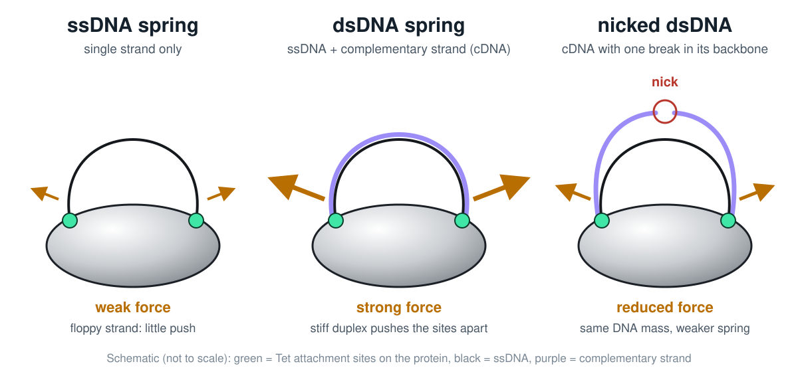

| Spring | What it is | Force on the two attachment sites |
|---|---|---|
| **ssDNA** | a single strand | floppy: little force |
| **dsDNA** | ssDNA plus its complementary strand (cDNA) | the stiff duplex must bend, so it pushes the sites apart much harder |
| **Nicked dsDNA** | dsDNA whose cDNA has one break in its backbone | the same DNA on the protein, but the nick relieves bending stress, so it delivers less force |

**Why it matters.** The three carry similar amounts of DNA but apply different forces. Used as controls, they separate cause from side effect: a change that appears only with the stronger spring is due to force, not to steric hindrance from simply having DNA there.

### 1.3 The project goals for each protein: "SAM" [S4]

- **Synthesis.** First, obtain gel evidence that the circular 1 DNA : 1 protein product can be synthesised. Then obtain a large purified batch for analysis.
- **Assay.**
  - Functional assays of the protein under mechanical tension from the attached spring.
  - Structural imaging assays (cryoEM, etc.).
- **MD analysis.**
  - A suitability test: can the DNA spring meaningfully perturb this protein's structure?
  - A computational and theoretical complement to the experiments, for example force modelling of DNA-spring dynamics.

### 1.4 Chemistry, constructs and how I read the gels

The work follows the lab's ubiquitin chimera preprint (Boral, Schnebly *et al.*, bioRxiv 2026.07.05, *Conformational changes induced in ubiquitin by circular protein–DNA chimeras*).

**Constructs:**

- **Tetrazine (Tet) sites.** The protein carries the unnatural amino acid **Tet2-Et**, a tetrazine-bearing phenylalanine, at one site (**1-tet**) or two sites (**2-tet**).
  - 1-tet can only form *linear* chimeras, so it is the built-in control.
  - 2-tet can close a *circle*.
- **DNA.** The ssDNA (50 nt or 80 nt) carries a click partner of tetrazine at **both** ends: **TCO** or **BCN**.
- **Spring.** Adding the complementary strand (**cDNA**, "+cDNA", "hybridised") turns the attached ssDNA into the stiff dsDNA spring.

**Species on an SDS-PAGE gel.** From slow (large, top) to fast:

1. multi-protein / multi-DNA species: 2 protein + 2 DNA (chain or dimeric ring), 2 protein + 1 DNA (one strand bridging two proteins);
2. the linear 1 protein + 1 DNA chimera;
3. the circular 1 protein + 1 DNA chimera (2-tet only);
4. free DNA, faint in a protein stain;
5. unreacted protein.

**Two key gel signatures:**

- **Linear and circular 1 : 1 ssDNA chimeras have the same mass**, so weight alone cannot tell them apart [S6].
- **Hybridisation separates them.**
  - *sfGFP:* with cDNA, the linear chimera runs faster (shifts down) while the circular chimera runs slower (shifts up) [S6].
  - *PP2A:* the 1 : 1 circular pp2a + dsDNA band appears *just below* the linear pp2a + DNA band, as in the preprint's Fig. 2. The up-shifted band is the 2 pp2a + 2 dsDNA dimer ring, which is the unwanted product [S26, S29, S33].

**How the gel figures were built.** In the deck, every gel was first drawn as an animated schematic. Lanes were revealed in a fixed order:

1. controls;
2. 1-tet;
3. 2-tet;
4. hybridised lanes.

The product of interest was highlighted, and then the real gel image was shown. The interpretations below follow those animations. The real gel images are in `figures/gels/`.

---

## 2. sfGFP chimeras

### 2.1 Starting point, four months ago [S5]

| Area | Status when I arrived | My to-do |
|---|---|---|
| Synthesis | SeArre Abebe and Micheal Schnebly had purified WT and tet-mutant sfGFP. Micheal had first seen gel evidence of circular product on tet-mutant sfGFP just before I arrived. | Obtain a batch of purified sfGFP chimera for analysis. |
| Assay | SeArre had initialised the fluorometer; no protein readings had been taken. | Run fluorometry once purified chimera was available. |
| MD | Darartu Gamada had initial talks with Doeke in 2020 about MD of a ubiquitin with cysteine attachments; no results were documented in the notebook. | Set up an MD system for tet-TCO/BCN protein chimeras. |

### 2.2 Synthesis

#### Experiment S-1. How do we identify circular products? [S6]

- **Why.** A circular 2-tet chimera and a linear chimera have the same mass, so a single gel band cannot tell them apart.
- **What I did.** I ran an SDS-PAGE gel with five sample groups:
  - 1-tet sfGFP with TCO DNA;
  - 1-tet sfGFP with BCN DNA;
  - sfGFP alone;
  - 2-tet sfGFP with TCO DNA;
  - 2-tet sfGFP with BCN DNA.

  Each DNA group was run without and with cDNA.
- **Result.**
  - sfGFP alone sets the bottom reference.
  - 1-tet lanes show the sfGFP + ssDNA band, which can only be linear, plus a 2 sfGFP + ssDNA bridged band.
  - 2-tet lanes show a sfGFP + ssDNA band that may be circular or linear, plus a 2 sfGFP + 2 ssDNA band, likely a dimeric ring.
  - Adding cDNA makes the **1-tet** chimera run **faster** (linear) and the **2-tet** chimera run **slower** (circular).
- **Interpretation.** The up-shifted 2-tet + cDNA band is the **circular sfGFP–dsDNA chimera**, the product of interest. It forms with both TCO and BCN DNA.
- **What it led to.** Hybridisation plus the 1-tet comparison became my standard test for circular product on every later gel.

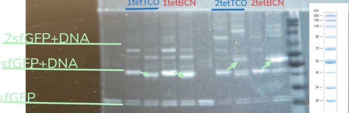

#### Experiment S-2. Big batch at high purity [S7]

- **Why.** Fluorometry, and later cryoEM, need a large, clean sample.
- **What I did.** I made a big batch of the 2-tet circular chimera and checked it by gel, without and with cDNA.
- **Result.** The purified sfGFP + ssDNA showed one dominant chimera band, with only faint traces above it. With cDNA, almost the whole band shifted up, which is the circular signature.
- **Interpretation.** I had a **high-purity, big-batch circular sfGFP–dsDNA chimera**. My status summary [S24] records that the yield was high enough to need no further purification, which makes the route high-throughput and cheap.
- **What it led to.** These samples were used for all the fluorometry below. Micheal also loaded my sfGFP samples onto cryoEM grids, which are awaiting an imaging session [S42].

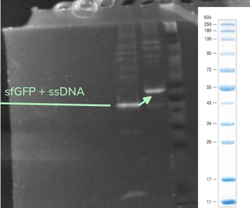

### 2.3 Fluorometry: do the tet groups or spring tension change fluorescence? [S8–S12]

**Question [S8].** Now that we have purified chimeras, does adding the tet groups, or the mechanical tension of the DNA spring, change sfGFP's fluorescence?

#### Instrument and spectra [S8]

- **Instrument.** A HORIBA Jobin Yvon **Fluorolog-3**. The light path:
  1. a Xe lamp;
  2. the excitation monochromator, which picks the colour that hits the sample;
  3. the cuvette;
  4. the emission monochromator at 90°, which picks the colour counted;
  5. detector **S1**.

  A reference photodiode, **R1**, tracks the lamp. I always use the lamp-corrected excitation signal, S1 ÷ R1.
- **Excitation spectrum.** Detect at **510 nm** and sweep the excitation over **400 → 500 nm**. This shows which colours the chromophore absorbs and turns into fluorescence.
- **Emission spectrum.** Excite at **485 nm** and sweep detection over **500 → 600 nm**. This shows what colour comes out, and how much.
- **Wavelengths.** 485 nm and 510 nm are sfGFP's known excitation and emission maxima. The small **400 nm** excitation band comes from the **neutral chromophore**, while the main peak is the anionic chromophore. The 400 nm band is the basis of my metric.

#### Choosing a metric: the band ratio [S9]

- **Why.** Our samples were not all at the same concentration, so raw intensities could not simply be compared.
- **What I did.** I recorded a 1-tet sfGFP concentration series on 2026-08-25:
  - five concentrations, 2, 4, 8, 16 and 32 µM;
  - 3 scans each;
  - excitation and emission spectra both recorded.
- **Result: fluorescence is not linear in concentration.**
  - 16× more protein (2 → 32 µM) gave only **11×** more $I(\text{peak})$.
  - On a log axis, each doubling should lift a curve by the same step. 2 → 4 → 8 µM do. 8 → 16 → 32 µM rise less and less (×1.8, then ×1.4), and the measured $I(\text{peak})$ falls below the proportional line.
- **The metric.**
  $$\text{band ratio} = \frac{I(400)}{I(\text{peak})}$$
  Both values are read off the same lamp-corrected excitation spectrum:
  - $I(\text{peak})$ is the excitation maximum at 484–486 nm, the anionic chromophore;
  - $I(400)$ is the 400 nm neutral-chromophore band.

  Because both come from one spectrum, concentration cancels. The ratio stayed at **0.097–0.105 from 2 to 8 µM**.

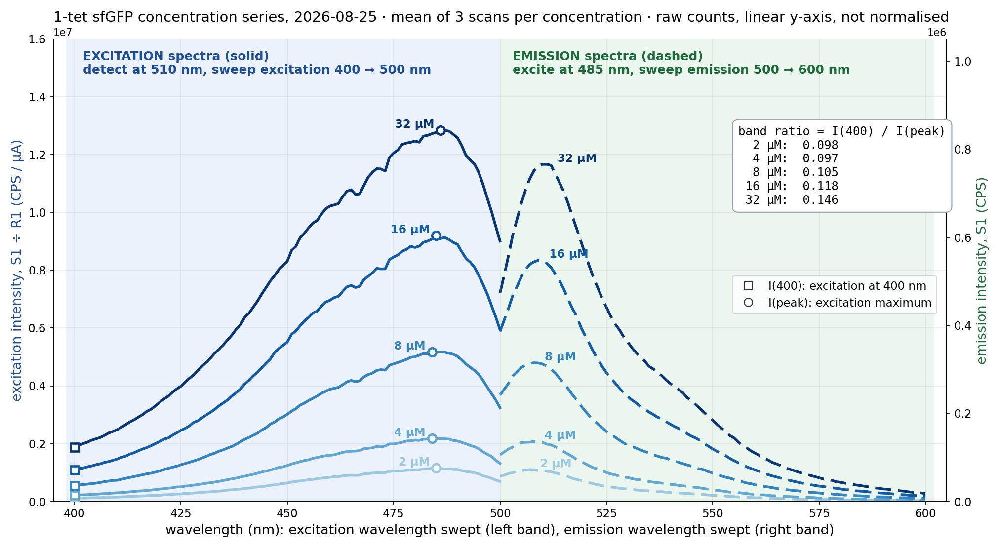

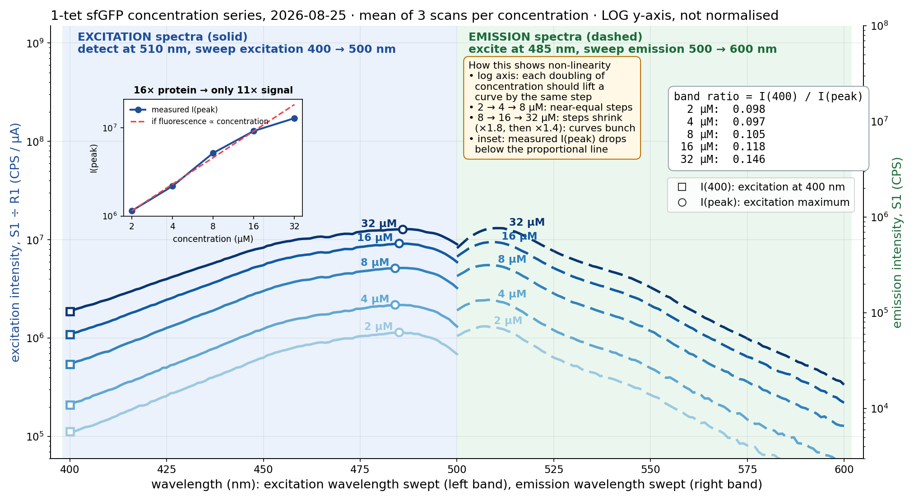

#### Experiment F-1. Concentration ladder: the inner filter effect [S10]

- **Why.** Before trusting the band ratio, I needed to know over what range it really is concentration-independent.
- **What I did.** I measured the band ratio of the 1-tet ladder (2026-08-25; mean ± 1 SD, n = 3).
- **Result.**

| Concentration | 2 µM | 4 µM | 8 µM | 16 µM | 32 µM |
|---|---|---|---|---|---|
| Band ratio | 0.0979 | 0.0963 | 0.1047 (within ≈ 7 % of the low-concentration value) | 0.1184 (+21 %) | 0.1456 |

- **Interpretation: the inner filter effect.** At high concentration the sample absorbs much of the excitation light before it reaches the centre of the cuvette, where the detector looks. The more strongly a wavelength is absorbed, the more of it is lost. sfGFP absorbs strongly at its 485 nm peak but only weakly at 400 nm. So:
  - $I(\text{peak})$ falls;
  - $I(400)$ barely changes;
  - the ratio rises.

  The literature reports the effect as noticeable from ≈ 5 µM (Lakowicz, *Principles of Fluorescence Spectroscopy*, 3rd ed., ch. 2; Kubista *et al.*, *Analyst* 119, 417, 1994). Here the ratio is flat up to 8 µM and rises from 16 µM.
- **What it led to.** I kept every later reading at **≤ 10 µM**, inside the flat range. That justifies the band ratio as my metric.

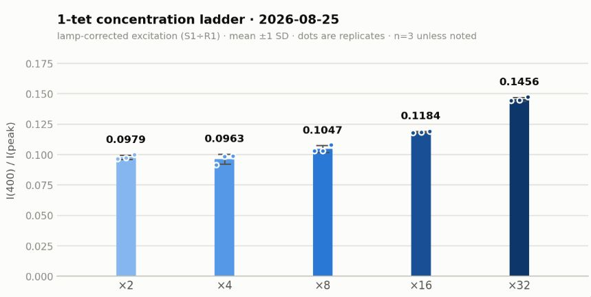

#### Experiment F-2. Do the tetrazine groups quench fluorescence? [S11]

- **Why.** The tetrazine on each Tet2-Et residue might change sfGFP's fluorescence on its own, before any DNA is attached. This had to be known before force effects could be interpreted.
- **What I did.** I compared 0-tet, 1-tet and 2-tet sfGFP in three attempts. Values are mean band ratios.
- **Result.**

| Attempt | Date | 0-tet | 1-tet | 2-tet | Concentrations |
|---|---|---|---|---|---|
| 1 | 2026-08-12 | 0.1515 | 0.1141 | 0.1066 | all ≈ 4 µM, *estimated* |
| 2 | 2026-08-21 | 0.1392 | 0.1070 | 0.1122 (n = 2) | 8 / 10 / 10 µM |
| 3 | 2026-08-21 | 0.1885 | 0.1730 (wide spread between replicates) | 0.1283 | 1.3 / 3.3 / 1.5 µM |

  > Note: Attempt 1's concentrations are estimates, not measurements. We had no accurate BCA or NanoDrop readings yet, and we trusted a "40 µM" stock that turned out to be mislabelled. Its band ratios are real measurements.

- **Interpretation.**
  - In all three attempts, untagged (0-tet) sfGFP has the **highest ratio**: adding tetrazine dims the excitation band.
  - Both tet forms are affected, and the trend holds in every attempt.
  - Absolute ratios differ between days and concentrations, so I compare only within an attempt.
- **What it led to.** This **reproduced the known tet-quenching result** [S24]. It also showed that tet chemistry alone shifts the metric, so force comparisons have to be made between chimeras that share the same chemistry.

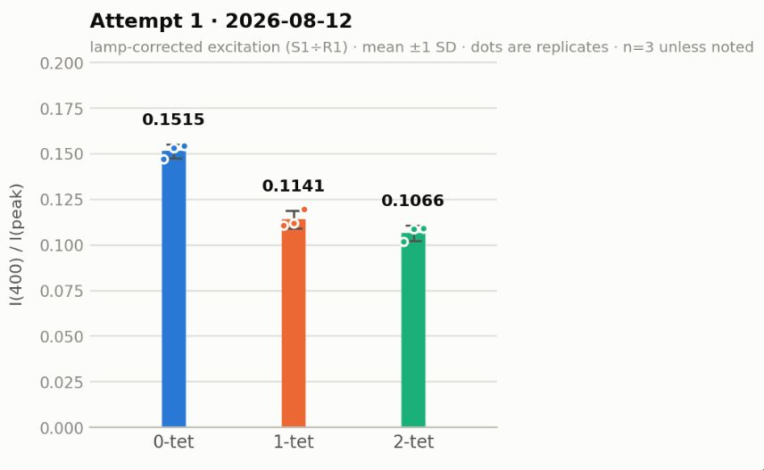

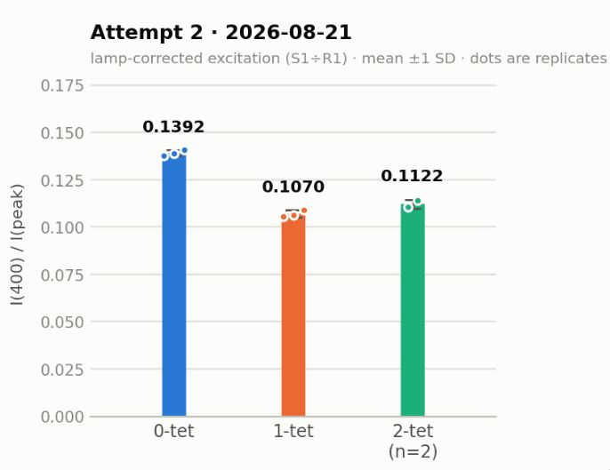

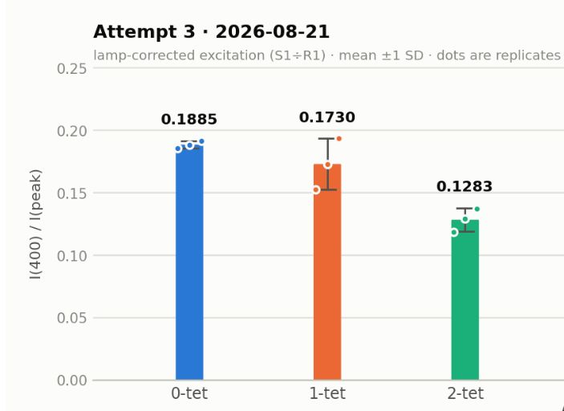

#### Experiment F-3. Does spring force change fluorescence? [S12]

- **Why.** This is the central assay question. ss, ds and nicked chimeras carry the same chemistry but apply different forces.
- **What I did.** I measured the ssDNA, dsDNA and nicked-dsDNA chimeras, all at 10 µM, in two attempts on 2026-08-28.
- **Result.**

| Attempt | ssDNA (no spring tension) | dsDNA (under spring force) | nicked dsDNA (relaxed control) |
|---|---|---|---|
| 1 | 0.1278 | 0.1159 | 0.1195 |
| 2 | 0.1227 | 0.1085 | 0.1134 |

- **Interpretation.**
  - The band ratio is **roughly the same for all three springs** (≈ 0.11–0.13) in both attempts. There is no meaningful trend with spring force, unlike the clear drop seen for tet quenching.
  - The force-bearing dsDNA is lowest in both attempts. That is at most a weak effect, which I recorded as "weak evidence" of a spectral change due to force [S24].
- **What it led to.** I wanted to know *why* the fluorescence barely moves. That question motivated the MD below; Section 2.4.11 gives the answer.

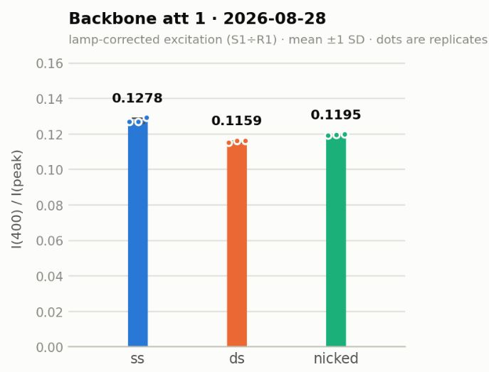

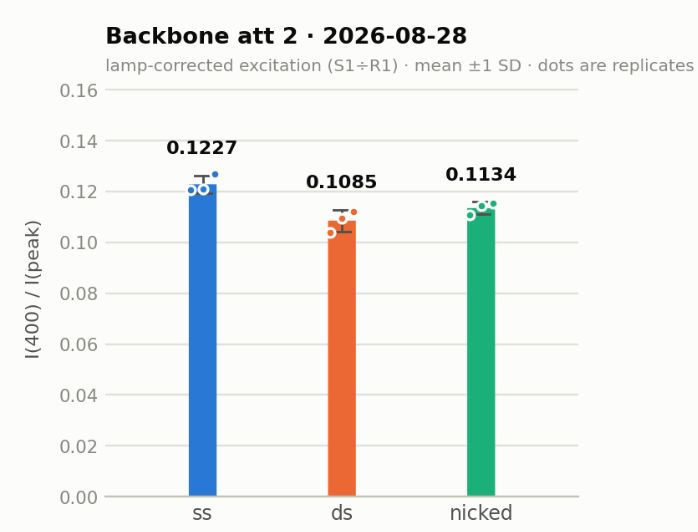

### 2.4 Molecular dynamics of the sfGFP chimeras [S13–S23]

#### 2.4.1 What MD should answer [S13]

| Analysis | Question |
|---|---|
| Ramachandran plots | Does adding the tet groups significantly change the protein's local conformation? |
| Backbone rigidity (RMSF) | How far does the spring deform the whole scaffold? Does the protein stay structurally intact? |
| Forces applied (force field vs model) | How much force does the DNA spring actually transmit? Do theoretical force models agree with the force field? |
| DNA dynamics | Is the DNA kinked or coiled (under torsion), which would change the force it applies? Does it interact with the protein in other ways? |

The overall MD goals were:

- **force modelling**, to make the system reproducible and transferable to other proteins;
- **suitability testing** of candidate proteins for study under a DNA spring.

#### 2.4.2 The protein and the simulated systems [S14]

- **sfGFP** has 238 residues:
  - **Barrel:** eleven β-strands form the rigid β-barrel wall, ≈ 42 Å tall and 24 Å across.
  - **Chromophore:** a central α-helix threads the barrel axis and carries the chromophore, which is made from Thr65–Tyr66–Gly67 and sealed off from solvent.
  - **Loops:** short, irregular segments join the strands at the two barrel caps. Nothing holds them in the sheet, so they are the most mobile parts (e.g. residues 189–194).
- **Attachment.** Tet2-Et tethers clicked to sTCO-DNA sit at **Asp133** and **Asn149**, 31.3 Å apart across the barrel. **His148**, which hydrogen-bonds the chromophore, lies between them.
- **Systems compared:**
  - WT sfGFP;
  - tethers unclicked, and tethers clicked with no DNA (the zero-force reference);
  - DNA springs of different lengths (27 bp, 40 bp);
  - dsDNA vs ssDNA;
  - intact vs nicked duplex;
  - a direct force clamp.
- **Scale.** **4,050 ns of production, 81 replicates across 17 systems.** The animations show the 27 bp spring chimera over 50 ns.

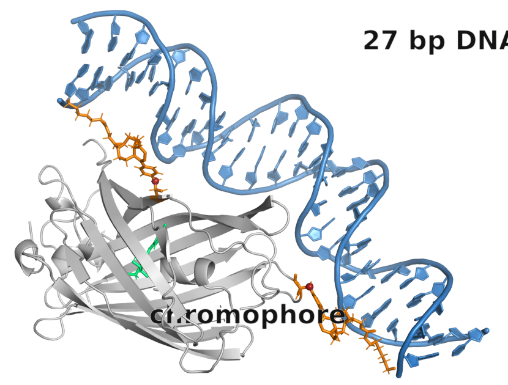

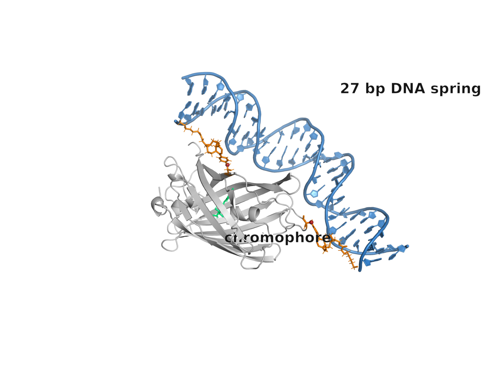

> **Methods detail from the project repository, not shown on the slides** (`MD simulations/sfGFP/README.md`):
>
> - **Engine and force field:** OpenMM with ff14SB, DNA.OL15, TIP3P water, Joung–Cheatham ions, and Li/Merz 12-6 Mg²⁺.
> - **Conditions:** 150 mM NaCl, ≈ 5 mM MgCl₂ in the DNA systems, 300 K.
> - **Structure and sites:** PDB 2B3P (sfGFP, 1.40 Å). Tet2-Et is introduced at two amber (TAG) codons.
> - **Integration:** 4 fs steps with hydrogen-mass repartitioning.
> - **Two kinds of spring build:** the repository separates earlier "two-arm" builds (S3–S5, where the DNA is linked to two different strands) from corrected, genuinely closed-loop builds (L3–L5). The animations on the slides use the 27 bp two-arm build. Check which build each quoted number comes from before publishing it.

#### 2.4.3 Ramachandran plots at the modified sites [S15]

- **Question.** Do the tet groups change the local backbone conformation?
- **What I did.** I plotted the backbone φ/ψ angles of residues 133 and 149 for three systems: WT, unclicked 2× Tet2-Et, and the clicked adduct.
- **Result:**

| Site | WT (φ, ψ) | Unclicked Tet (φ, ψ) | Clicked (φ, ψ) |
|---|---|---|---|
| Asp133 (rare left-handed α basin) | +57, +16 | +74, +2 (≈ 17.5° out of the basin) | +60, +18 (back beside WT) |
| Asn149 (β) | −127, +137 | −125, +124 | −114, +133 |

- **Interpretation.** There is **no significant change**: only a local, reversible shift at the one positive-φ site, which the click itself reverses.

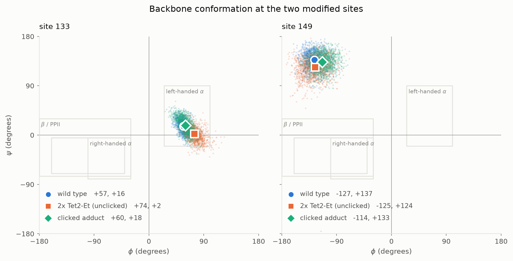

#### 2.4.4 Backbone rigidity: RMSF and a direct force clamp [S16]

- **What I did:**
  - I computed the per-residue Cα RMSF after aligning every frame on the barrel core.
  - I applied a constant **axial force clamp** directly between the Cβ atoms of Asp133 and Asn149 on the unclicked protein, with no DNA, as a controlled stand-in for a spring (3 replicates).
- **Result:**
  - The β-barrel stays uniformly rigid, **≈ 0.4 Å RMSF on the strands**, in every system, including WT with no force at all. The traces overlie each other; only the loops and tethers move. The tallest peak is residues 189–194 (≈ 1.5 Å), then 155–158 and 211–212.
  - With no force, the site distance is **31.61 ± 0.07 Å**.
  - Going from 0 to 20 pN moves it by only **0.14 Å** (to 31.75 Å). The dip at 4 pN is replicate noise.
  - The compliance is 0.0105 ± 0.0057 Å/pN, which includes zero, so the site-to-site stiffness is **κ > 107 $k_BT$ nm⁻²**.
- **Interpretation.** The sfGFP backbone is already extremely rigid without force, and force barely changes it.

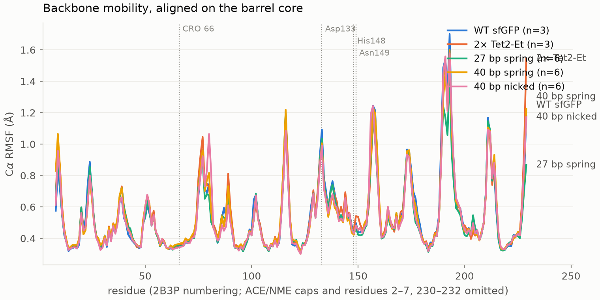

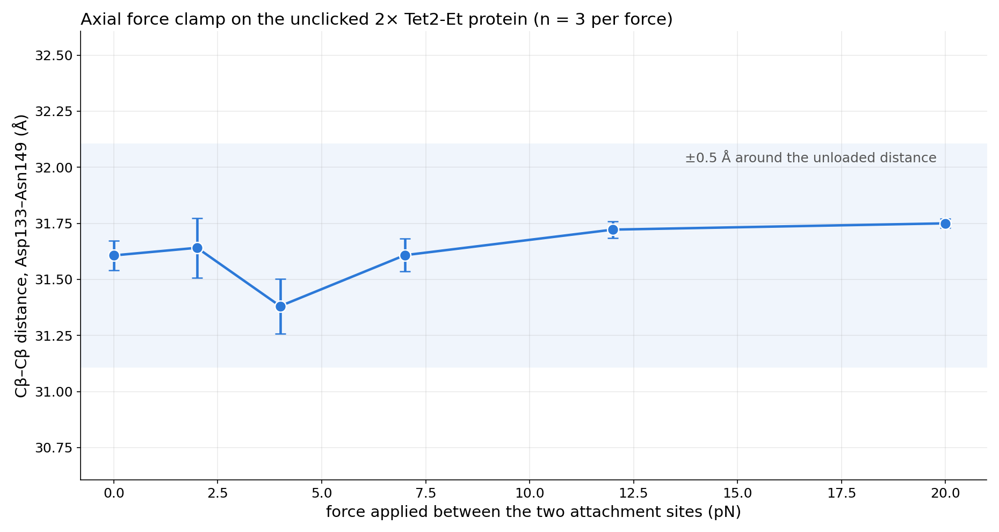

#### 2.4.5 How much force does the spring apply? Force field vs Zocchi's model [S17]

- **Why.** I wanted to check that the MD force field agrees with the established DNA-spring model (Zocchi, *Molecular Machines*, §2.15).
- **What I did.** I measured the push of a **bare duplex** held at the chimeras' end-to-end distances, and compared it with Zocchi's model evaluated at the same geometry. The model uses $\tau_c$ = 34 pN nm (27 if nicked) and $B$ = 200 pN nm², at 63–73 Å.
- **Result:**

| DNA spring | MD force field (measured) | Zocchi model (at our geometry) | Ratio |
|---|---|---|---|
| 27 bp dsDNA | 28.0 ± 1.2 pN | 5.5–6.8 pN | ≈ 4–5× |
| 40 bp dsDNA | 15.8 ± 1.6 pN | 3.0–3.2 pN | ≈ 5× |
| 40 bp nicked dsDNA | 13.2 ± 1.3 pN | 2.3–2.5 pN | ≈ 5–6× |

  MD values are mean ± sem of 25, 10 and 10 runs.

- **Interpretation.** At first sight they disagree: the force field gives about **5× more force** than Zocchi's model for every spring. Sections 2.4.6–2.4.10 explain why.

#### 2.4.6 Kinked vs unkinked DNA: the shape sets the force [S18]

- **Setting.** Both duplex ends are held closer than the duplex length ($x < L$), so the DNA must bend. The question is where the bending goes.
- **Unkinked** (Euler buckling). The bend is shared by every base-pair step, a few degrees each. The whole rod stores bending energy and pushes back with about the Euler load, $\pi^2 B/L^2$: ≈ 24 pN for 27 bp.
- **Kinked.** One step breaks sharply (base stacking lost, often an opened pair) while the two arms stay straight and relaxed. The kink acts as a **release valve**: the push is capped by the critical kink torque $\tau_c$, so only **≈ 5–7 pN** reaches the protein.
- **Consequence.** Squeezing the ends closer, the smooth rod keeps pushing at about its Euler load, while the kinked rod stays weak. **Whether the DNA kinks decides whether the spring delivers tens of pN or a few.**

#### 2.4.7 How the force numbers were obtained: the bare-duplex set-up [S19]

The system is a bare 27 bp dsDNA duplex in water and ions at 300 K, with no protein. Its variables:

| Symbol | Meaning |
|---|---|
| $L$ | length along the helix: 89 Å for 27 bp |
| $x_0$ | rest length of a virtual spring tying the two ends; set by me, with $x_0 < L$ forcing a bend (e.g. 50 Å) |
| $x(t)$ | instantaneous end-to-end distance; jiggles ≈ ±1 Å from thermal motion at 300 K, not from any kick |
| $\langle x\rangle$ | time average of $x(t)$ over the run; the duplex pushes, so it sits slightly beyond $x_0$ (e.g. 50.94 vs 50.00 Å) |
| $f = k(\langle x\rangle - x_0)$ | the force, read off the stretch of the restraint |

- **Per run.** $x_0$ is fixed and $x$ stays within ≈ 1 Å, so each run gives one point $(\langle x\rangle, f)$. The 27 bp curve uses 25 runs.
- **Model curve.** Zocchi's model predicts $f(x)$ with no simulation, from the bending stiffness $B$ (≈ 200 pN nm²) and the kink torque $\tau_c$ (≈ 34 pN nm, 27 if nicked). Below a critical distance $x_c$, the model rod kinks into two straight arms of length $R$, and its push drops to a few pN.

#### 2.4.8 Does the DNA kink in MD? DNA dynamics [S20]

- **What I did.**
  - I computed the axis bend at every base-pair step (the angle between the helix axes on either side), averaged over 6 runs per chimera.
  - I overlaid what a kinked duplex would look like at the same end-to-end distance, using Zocchi's kink geometry:
    $$\theta = \arccos\!\Big(\frac{x}{2R}\Big) - \Delta,\quad \Delta = \arccos\!\Big(\frac{x_c}{2R}\Big),\quad R = \frac{L}{2}\Big(1-\frac{\gamma^2}{90}\Big),\quad x_c = L\Big(1-\frac{\gamma^2}{15}\Big),\quad \gamma = \frac{L\tau_c}{2B}$$
    The duplex bends by $2\theta$. That is **51°** for 27 bp at $x$ = 68 Å, and **76°** for 40 bp at 66 Å, at a single step, with 0° elsewhere.
- **Result:**
  - Zoomed in, the MD profiles look spiky: steps vary between 3° and 8°.
  - On the same axis as the kinked prediction, those "spikes" vanish into the 0–10° band. The duplex bends **smoothly, 4.8–5.2° per bp on average, with no kink**.
  - The DNA touches the protein in **72–98 % of frames**: local contact, not action at a distance.
- **Interpretation.** No kink and no coiling: the DNA bends smoothly and lies against the protein.

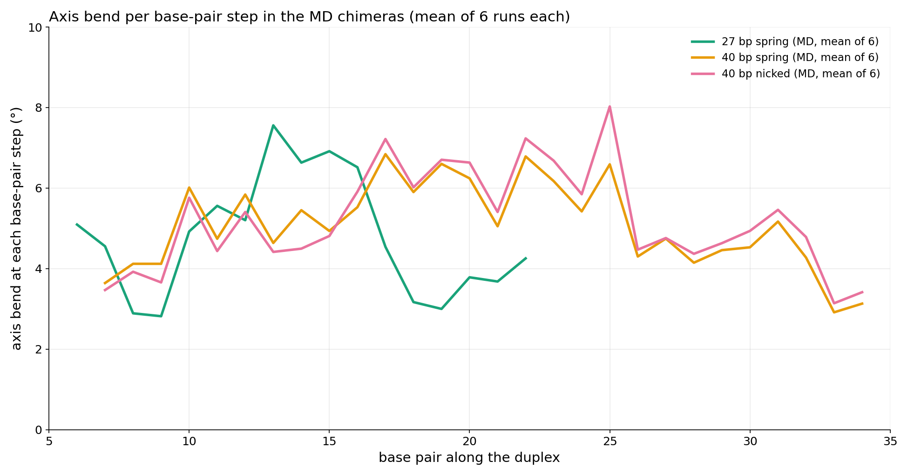

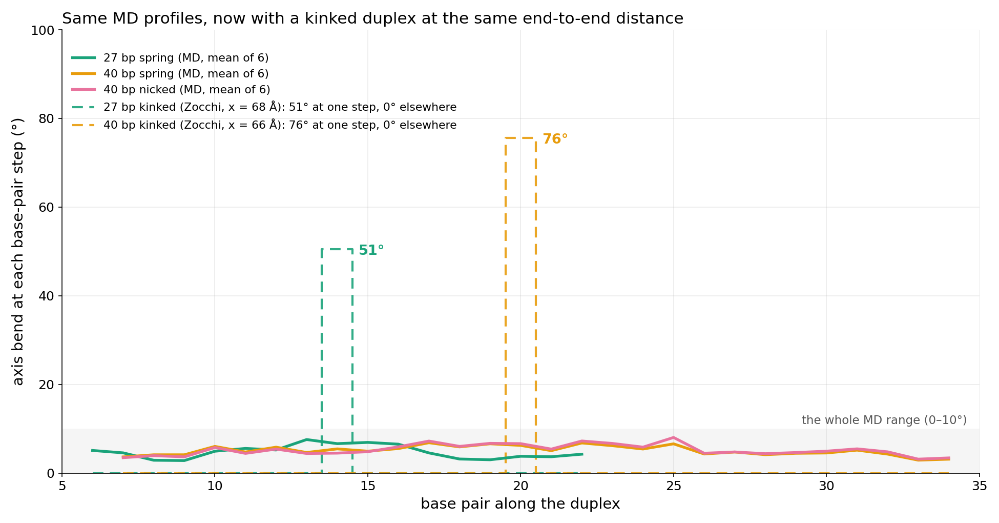

#### 2.4.9 Why Zocchi's model puts our springs in the kinked regime [S21]

I evaluated Zocchi's equations with our MD geometry, where the ends sit $x_{MD}$ = 63–73 Å apart and the duplex bends 4.8–5.2°/bp.

**Inputs:**

- $L = 0.33\,\text{nm}\times N_{bp}$, i.e. 8.91 nm for 27 bp and 13.2 nm for 40 bp;
- $B = k_BT\,\ell_p \approx 200$ pN nm²;
- $\tau_c$ = 34 pN nm (intact) or 27 pN nm (nicked).

**Calculation:**

1. **Kink parameter.** $\gamma = L\tau_c/2B$ = **0.76** (27 bp) and **1.12** (40 bp).
2. **Critical distance.** $x_c = L(1-\gamma^2/15)$ = **86 Å** (27 bp) and **121 Å** (40 bp). Both exceed $x_{MD}$ = 63–73 Å, so the model is in the **kinked regime**.
3. **Same conclusion from curvature.** Kinking starts when the bending torque $B\kappa$ reaches $\tau_c$. That gives $\kappa_c = \tau_c/B$, which is **3.2°/bp** (2.6°/bp nicked). That is less than the 4.8–5.2°/bp in the MD.
4. **Predicted force on the kinked branch.**
   $$f_{\text{kinked}}(x) = \frac{\tau_c}{2R\sqrt{1-(x/2R)^2}}$$
   This gives **5.5–6.8 pN** (27 bp) and **3.0–3.2 pN** (40 bp).

**Main idea.**

- Zocchi's model has a threshold torque $\tau_c$. Once bending exceeds it, the DNA must kink and the push collapses to a few pN.
- The MD force field has **no such threshold**. A kink could only appear by base pairs actually breaking, and that did not happen at 4.8–5.2°/bp.
- So the simulated duplex stays unkinked and keeps pushing at tens of pN.

#### 2.4.10 Kinked vs unkinked regime, and the force field [S22]

**Zocchi's force against end-to-end distance:**

- **Kinked branch** ($x < x_c$): the kink takes up the bending and the push collapses to a few pN (5–7 pN for 27 bp, ≈ 3 pN for 40 bp).
- **Unkinked branch:** the push stays near the Euler load, $\pi^2 B/L^2 \approx 10B/L^2$. That is **24.9 pN** (27 bp) and **11.3 pN** (40 bp), almost independent of $x$.
- **Our chimeras** sit well inside the model's kinked regime: 5× less force than an unkinked rod would give.

**Recomputing Zocchi at the force field's own distances:**

| Spring | Zocchi, unkinked | MD force field | Zocchi, kinked |
|---|---|---|---|
| 27 bp | 24.1 pN | 28.0 pN | 4.6 pN |
| 40 bp | 13.9 pN | 15.8 pN | 3.0 pN |
| 40 bp nicked | 11.9 pN | 13.2 pN | 2.3 pN |

**Takeaway.**

- The force field does not contradict Zocchi's spring. Its duplex never kinks, so it follows his **unkinked** branch, and there the two agree **within 1.1–1.2×**.
- The only disagreement is whether DNA kinks at 4.8–5.2°/bp. That is a physical question for experiment, not an inconsistency in the simulations.

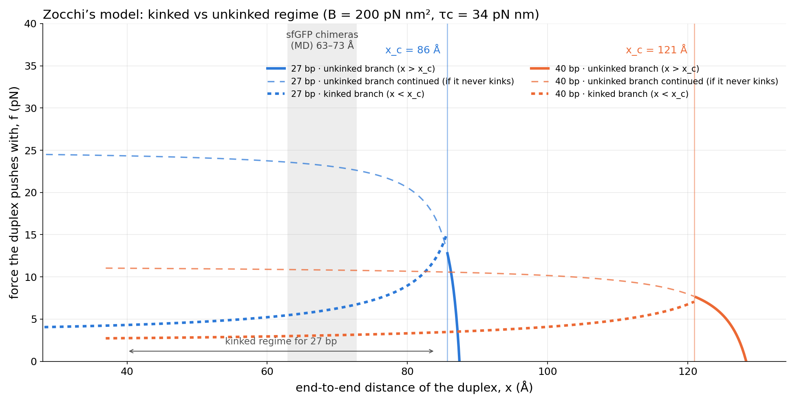

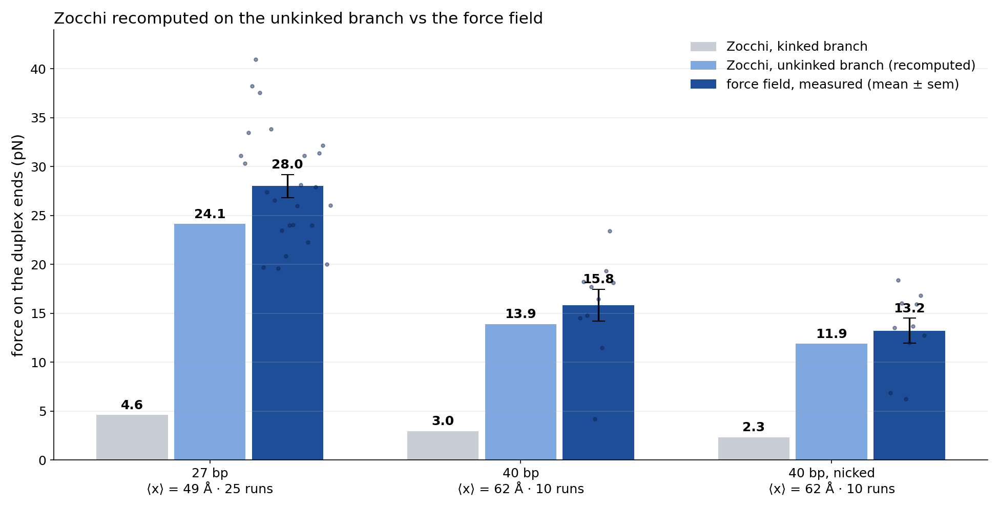

#### 2.4.11 Why fluorometry saw no change across ss, ds and nicked [S23]

- **What sets the colour and brightness.** The chromophore (CRO 66) is buried in the barrel and held flat by a hydrogen-bond network:
  - Thr203 and His148 bond the phenolate oxygen;
  - Arg96 and Gln94 bond the imidazolinone carbonyl.

  Its wavelengths depend on this electrostatic environment and on its protonation state. Its brightness drops if it can twist about the two bonds of the methine bridge; a free chromophore is essentially dark. His148 sits between the two attachment sites, on the mechanical path from spring to fluorophore.
- **What I did.** I computed the occupancy of each chromophore hydrogen bond (% of frames formed) in every system: WT, 2× Tet2-Et, clicked with no DNA, and the 27 bp, 40 bp and 40 bp-nicked springs. A bond counts as formed when H···acceptor < 2.5 Å and the D–H···A angle > 120° (mdtraj, `analysis/chromophore.py`). The H on an electronegative donor carries a partial positive charge and is pulled by a lone pair on the acceptor. That attraction is strong only when H is close to A and D–H points nearly straight at it, which is why both criteria are used.
- **Result:**
  - The load-bearing bonds hold in every system: **Arg96 100 %, Thr203 96–97 %, Gln94 92–97 %**.
  - His148 → phenolate is 72 % in WT and 72–82 % with springs, inside its own 39–92 % replicate scatter.
  - Chromophore planarity is unchanged: bridge twists τ 5.1–5.6° and φ 6.0–6.5° in all systems, with 9–11 cavity water molecules.
  - The barrel is stiff (Section 2.4.4).
- **Interpretation.** The springs never deform the chromophore's environment, so **no wavelength shift or band-ratio change is expected**. This agrees with my fluorometry (F-3). Seeing a change would need a softer attachment site or a far stronger force.

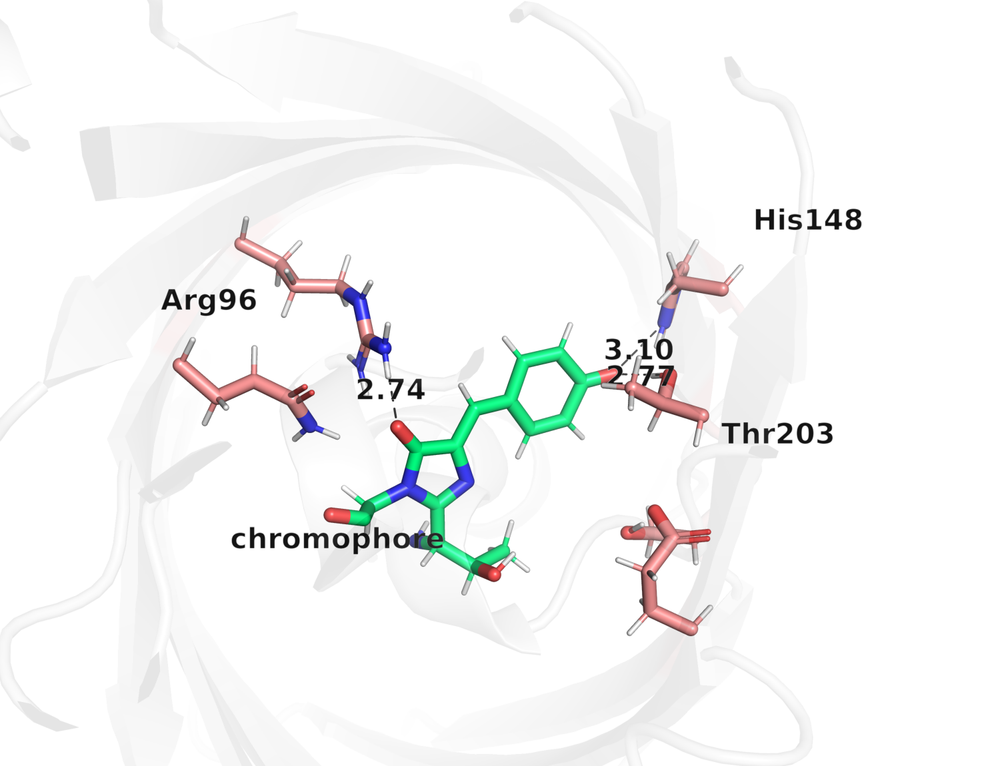

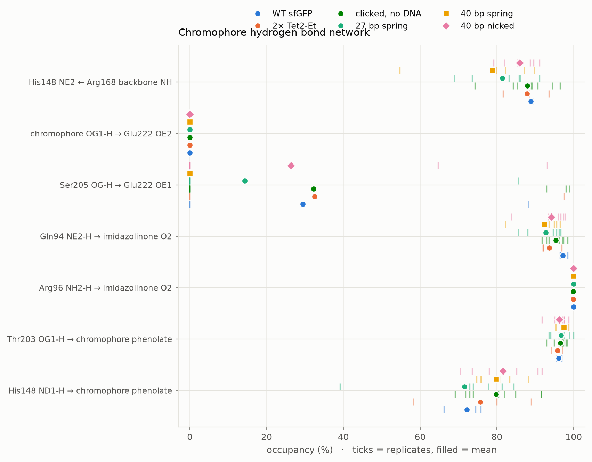

### 2.5 sfGFP: where I am now [S24]

| Area | Status |
|---|---|
| Synthesis | **[DONE]** A batch of purified sfGFP chimera. High yield without the need for purification: high-throughput and cheap. |
| Assay (fluorometry) | **[DONE]** Fluorometry readings on the purified chimeras. I reproduced the tet-quenching result and found weak evidence of a spectral change due to force. |
| MD | **[DONE]** MD system set up for the tet-TCO/BCN sfGFP chimeras. Rigid backbone and minimal deformation under force; the chromophore environment is largely unchanged under force, consistent with the fluorometry. |

**Overall conclusion for sfGFP.** sfGFP is a robust and easily made chimera. But its rigid barrel makes it a poor force sensor at these spring forces. The fluorometry null result and the MD agree, and the MD also explains the apparent force-field vs model disagreement. PP2A's A subunit is a horseshoe of HEAT repeats, and earlier MD in the literature shows it to be far more flexible [S42]. That makes it a more promising target for spring force (Section 3).

---

## 3. PP2A Aα chimeras

The protein here is the scaffold **A subunit (Aα)** of protein phosphatase 2A, written "pp2a" on the gels.

### 3.1 Starting point, four months ago [S25]

| Area | Status when I arrived | My to-do |
|---|---|---|
| Synthesis | SeArre and Micheal had purified WT and tet-mutant pp2a. Micheal had **not yet obtained gel evidence of a circular product**. | Obtain circular pp2a product. |
| Assay | Never attempted in the lab. | Plan the pp2a assays. |
| MD | Never attempted in the lab. The literature has MD of pp2a A-subunit isoforms and mutants, but none with mechanical tension or springs. | Set up an MD system for tet-TCO/BCN pp2a chimeras. |

### 3.2 Synthesis: from no circular product to proof of one

Each experiment in this chain answered the question raised by the one before.

#### Experiment P-1. Baseline: the wrong circular product, at poor yield [S26]

- **Why.** I needed to establish what the existing protocol gives.
- **What I did.** I ran 1-tet and 2-tet pp2a, each as protein alone, + ssDNA, and + ssDNA + cDNA.
- **Result:**
  - pp2a alone runs as a **doublet** near the bottom of the gel.
  - With 1-tet + ssDNA, the pp2a + ssDNA band can only be linear.
  - With 2-tet + ssDNA, a band of the same mass appears, which could be circular or linear.
  - On adding cDNA, the pp2a + DNA bands shift **down in both 1-tet and 2-tet in the same way**. 2-tet shows no new band that 1-tet lacks, so its band is linear too.
  - The only circular product is the **up-shifted 2 pp2a + 2 dsDNA ring**.
- **Interpretation.** There was **no 1 : 1 circular product**. The only circle was the wrong 2 : 2 dimer ring, and all 1 : 1 product was faint.
- **What it led to.** First shift the overall yield towards 1 : 1 products, then find out what blocks the circle.

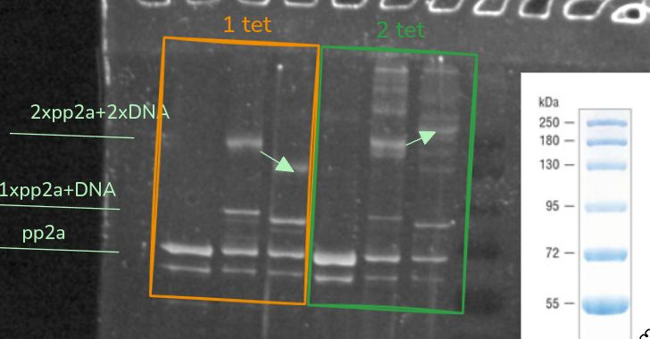

#### Experiment P-2. Finding 1: a 1 : 1 DNA : protein ratio gives the best yield [S27]

- **Why.** Before chasing circularity, I tried to move the products away from the 2 protein + 2 DNA bands towards the 1 protein + 1 DNA bands. The 1 : 1 bands are the ones that matter, since the goal is a 1 : 1 circular product. Here "yield" means more 1 pp2a + 1 DNA relative to 2 pp2a + 2 DNA, linear or circular.
- **What I did.** 2-tet pp2a was held at **4.0 µM** and reacted with 2-TCO ssDNA of **50 nt** or **80 nt** at **1.0, 2.0 or 4.0 µM**, i.e. DNA : protein **1 : 4, 1 : 2 and 1 : 1**. Each was run without and with cDNA (1.3, 2.5 or 5.0 µM, matched to the DNA), alongside a pp2a-only control. The full design is in the table below.
- **Result:**
  - At 1 : 4 the bands are faint.
  - 1 : 2 gives a stronger pp2a + ssDNA band, and **1 : 1 gives the strongest**, for both lengths.
  - With cDNA, the pp2a + DNA band shifts down (linear-like, as in P-1), and the 2 pp2a ring shifts up.
- **Interpretation.** **1 : 1 DNA : protein gives the most 1 pp2a + 1 DNA product** relative to 2 pp2a + 2 DNA, with or without cDNA.
- **What it led to.** I used a 1 : 1 ratio from then on.

| Condition (µM) | 1 | 2 | 3 | 4 | 5 | 6 | 7 | 8 | 9 | 10 | 11 | 12 | 13 |
|---|---|---|---|---|---|---|---|---|---|---|---|---|---|
| 2-tet pp2a | 4.0 | 4.0 | 4.0 | 4.0 | 4.0 | 4.0 | 4.0 | 4.0 | 4.0 | 4.0 | 4.0 | 4.0 | 4.0 |
| 2-TCO ssDNA 50 nt | 1.0 | 1.0 | 2.0 | 2.0 | 4.0 | 4.0 | | | | | | | |
| 2-TCO ssDNA 80 nt | | | | | | | 1.0 | 1.0 | 2.0 | 2.0 | 4.0 | 4.0 | |
| cDNA 50 nt | | 1.3 | | 2.5 | | 5.0 | | | | | | | |
| cDNA 80 nt | | | | | | | | 1.3 | | 2.5 | | 5.0 | |

Lane 15 was the ladder.

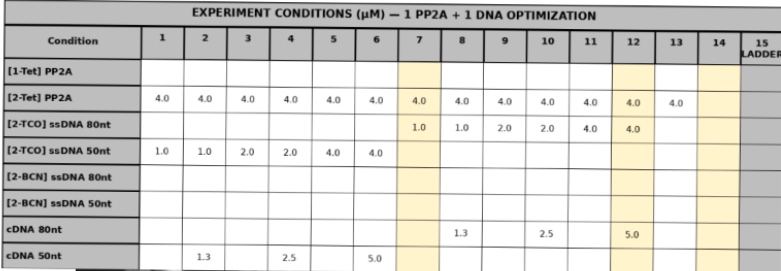

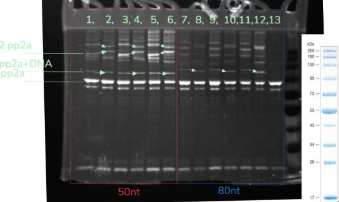

#### Experiment P-3. Cleaving the GST tag [S28]

- **Why.** One of Micheal's notebooks recorded that our pp2a mutants were made **with GST tags still present**. A bulky tag could block one of the two Tet groups and so prevent circularisation.
- **What I did.** I titrated thrombin (**0, 0.01, 0.05, 0.10, 0.25 and 0.50 U**) on GST-tagged pp2a.
- **Result:**
  - With no thrombin, uncleaved pp2a + GST runs slow, as a doublet.
  - At just **0.01 U**, most of the pp2a already drops to the faster, cleaved position.
  - With more thrombin, the released free GST band grows at the bottom while cleaved pp2a holds steady.
  - A faint uncleaved band remains in every lane, even at 0.50 U.
- **Interpretation.** Thrombin removes the GST tag efficiently even at the lowest dose; cleavage is near-complete but not total.
- **What it led to.** I tested whether cleaved pp2a can circularise (P-4).

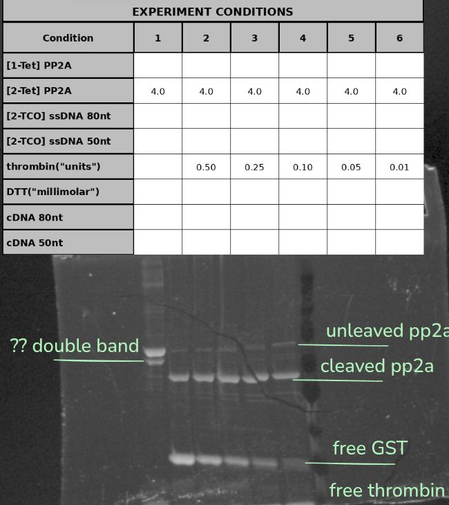

#### Experiment P-4. Finding 2: GST cleavage reveals a new band [S29]

- **Why.** To test whether removing GST allows the 1 : 1 circle to form.
- **What I did.** I reacted thrombin-cleaved 1-tet and 2-tet pp2a without DNA, with ssDNA, and with ssDNA + cDNA, next to an uncleaved (no-thrombin) control. I ran one gel and imaged it with a **protein stain** and a **DNA stain**.
- **Result:**
  - *Protein stain.* The 1-tet lanes show linear pp2a + DNA and a bridged dimer (2 pp2a + DNA), and nothing new. The **2-tet + cDNA lane shows a new band just below linear pp2a + dsDNA**.
  - *DNA stain.* The new band **contains DNA**, so it is a chimera.
- **Interpretation.** The new band is a **candidate circular pp2a + dsDNA**. It runs just below the linear chimera, as in the preprint's Fig. 2. Removing the GST tag was the step that unlocked it.
- **What it led to.** Raise its yield (P-5), then test rigorously whether it is circular (P-6 and P-7).

> Note: on the DNA-stain image, the drawn boxes read "2 tet" (left) and "1 tet" (middle), with the new band in the middle box. On the protein stain of the same layout, the middle box is 2-tet. Check the lane assignment against the notebook before publishing.

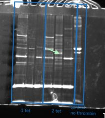

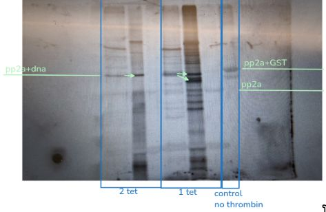

#### Experiment P-5. Finding 3: a longer BCN incubation raises the circular yield [S30]

- **Why.** I wanted to raise the yield of the new, potentially 1 : 1 circular band before running more confirmatory tests.
- **What I did.** I compared the standard **2 h BCN incubation** with a **12 h incubation**. The 12 h gel also included TCO DNA for comparison.
- **Result:**
  - *After 2 h:* 1-tet gives linear chimera. 2-tet + ssDNA gives mostly multimers, one strand bridging two pp2a. With cDNA, the new band below the linear chimera is only **faint**.
  - *After 12 h:* 1-tet is mostly linear chimera with little free pp2a. 2-tet + ssDNA (BCN or TCO) is mostly bridged dimers. With cDNA, the new band is **far stronger** than after 2 h, and **stronger with BCN than with TCO**.
- **Interpretation.** A longer incubation, with BCN, increases the candidate circular product.
- **What it led to.** I adopted the 12 h BCN incubation. That gave enough of the new band to test its identity.

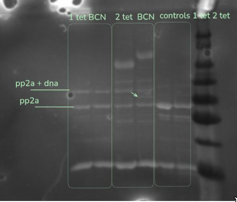

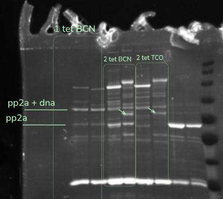

#### Experiment P-6. The TCO resin test: principle and validation [S31, S32]

**Why.** Is the new band *truly* circular? The most definitive test is a **TCO resin**.

**Principle [S31]:**

- The beads are coated with TCO, which clicks onto Tet: the same chemistry that attaches our DNA.
- Any protein with an **exposed Tet** clicks onto the beads and is **trapped**, so it never reaches the flow-through.
- A **1 : 1 circular product** uses both of its Tet groups for its DNA, so it **passes through**. Linear products keep a free Tet and are trapped.
- **Control:** excess TCO-PEG caps every Tet on 2-tet pp2a. PEG is a **cheap stand-in for DNA**, so the resin can be troubleshot without using expensive DNA.

**Validation [S32].** Packed resin was fixed at **25 µL** and the sample volume varied as packed resin : sample **1 : 1 → 1 : 2 → 1 : 3 → 1 : 4**.

- **Does the resin trap products with non-exposed Tet groups? No.**
  - pp2a alone runs fastest; one PEG cap (1-tet + PEG) slows it slightly.
  - PEG-capped 2-tet pp2a passes through the resin.
  - The flow-through band grows from 1 : 1 to 1 : 4, so more sample per 25 µL of resin means less unnecessary loss.
- **Does the resin trap products with exposed Tet groups? Yes.** After the resin, the flow-through lanes of uncapped pp2a are empty.
- **Practical finding.** The more sample per packed resin, the less unnecessary sample loss.

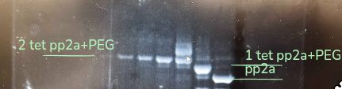

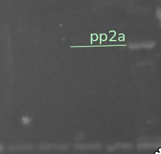

#### Experiment P-7. Proof of circular product, then SEC purification [S33]

**TCO resin on the reaction products:**

- **What I did.** I ran the input reaction (pp2a + ssDNA, and + cDNA), and then the same samples after TCO resin, next to pp2a alone.
- **Result:**
  - Two low bands also appear in pp2a alone, so they are not chimeras.
  - Without cDNA there is a strong 2 : 2 ring over a weaker 1 : 1 new band. With cDNA, the dimer ring shifts **up** and the 1 : 1 circle shifts **down**: circles run faster here.
  - **After the resin, free pp2a is captured and both circular products remain**: the 2 pp2a + 2 DNA ring and the new pp2a + DNA band.
- **Interpretation.** The new band survives the resin, so it has **no free Tet**. It is a true circle.

> **Milestone.** For the first time, this is **proof of circular product synthesis of a PP2A spring chimera in the Hekstra lab**.

**Size-exclusion chromatography (SEC):**

- **Why.** I needed to purify the circular product for the assays.
- **What I did.** I ran the resin-treated products on SEC and checked fractions F1–F6 on a gel against the pre-SEC sample.
- **Result.** The products spread over the fractions and were **too dilute to see**. This result was anticlimactic.
- **Idea, not yet tested.** Run the fraction volumes through a **His-tag (affinity) column** to concentrate them. Protein concentrators may need a volume overhead that we don't have.
- **What it led to.** Before debugging the SEC, I returned to **raising the yield of the circular product**, starting with **disulfide (cysteine) bond re-formation**, which links pp2a molecules together.

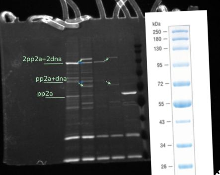

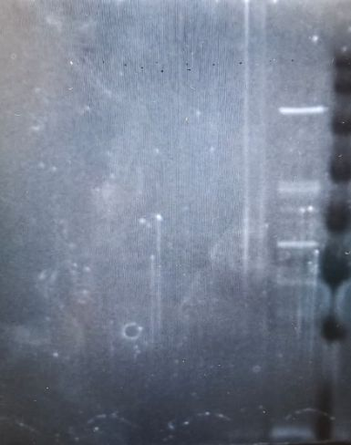

#### Experiment P-8. Why add DTT? Favouring the 1 : 1 circle [S34]

**Rationale:**

- **Without DTT**, cysteines on neighbouring pp2a molecules form **disulfide (S–S) bonds**, so the proteins stick together.
- A DNA strand can then click **across two proteins** (intermolecular), giving 2 pp2a + 2 DNA products.
- **DTT** reduces each S–S bond to two free –SH groups, so the proteins separate.
- Each strand can then close only on **its own** protein (intramolecular), giving the 1 pp2a + 1 DNA circle.
- **Expected:** more 1 : 1 circle and less 2 : 2.

#### Experiment P-9. DTT optimisation: DTT also inhibits click chemistry [S35]

- **Protocol.** pp2a is first incubated in DTT to reduce its disulfide bonds. The DTT is then **desalted away** before the DNA is added and clicks onto the Tet groups.
- **The catch.** **Click chemistry is still inhibited even after desalting** (right-hand gel). So I ran an experiment to find the **minimum DTT** that still reduces all or most disulfide bonds, so that as little DTT as possible is carried over into the click step.

**Left gel: how much DTT reduces the disulfides?**

- **What I did.** I ran pp2a in 6× loading dye with 0, 0.01, 0.1, 1 or 10 mM DTT, against a fully reduced reference in BME 2× loading dye.
- **Result:**
  - BME 2× dye gives one tight band.
  - With no DTT, unreduced pp2a smears far up the lane.
  - 0.01 mM still has a long upward smear. At 0.1 mM the smear persists while the band starts to rise and sharpen.
  - At 1 mM the smear shrinks to a short haze. At **10 mM** the band is tight, close to the BME reference.

**Right gel: does carried-over DTT block the click?**

- **What I did.** I ran pp2a + DNA + cDNA after 0, 8, 16 or 20 mM DTT, plus a no-DTT, no-cDNA control.
- **Result:**
  - With no DTT and no cDNA: pp2a + ssDNA and a bright 2 pp2a + 2 DNA band.
  - No DTT + cDNA: the 1 : 1 circle shifts down and the 2 : 2 ring shifts up.
  - 8 mM DTT: chimera bands remain, but only a **faint** circular band.
  - 16 mM: no 2 : 2 band, only faint pp2a + DNA and pp2a.
  - 20 mM: the weakest pp2a + DNA band, mostly unreacted pp2a.

**Interpretation.**

- The circular pp2a + dsDNA forms without DTT, barely at 8 mM, and **not at 16–20 mM**.
- Disulfide reduction needs roughly 1–10 mM in the dye test, so the useful window is narrow.
- The DTT carried over after desalting inhibits the click.

**Status: [PENDING].** Find the minimum effective DTT and/or improve its removal.

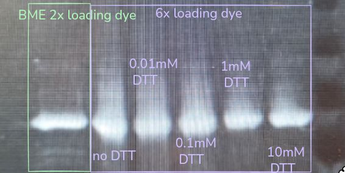

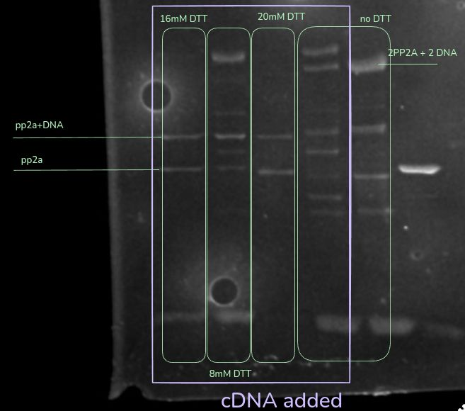

### 3.3 Planning the PP2A assays [S36–S41]

With at least some evidence of a circular product, the next step is to design assays that test **PP2A's physiological function under spring attachment**. That first requires the key features of PP2A.

#### 3.3.1 PP2A architecture [S36]

PP2A works as a three-subunit **holoenzyme**:

- **A, the scaffold** (PPP2R1A/B, ≈ 65 kDa). A horseshoe of **15 HEAT repeats** with no activity of its own; it holds the other two subunits in place. **This is the subunit we attach the DNA spring to.**
- **C, the catalytic subunit** (PPP2CA/B). The phosphatase itself, which binds HEAT 11–15. A + C form the **AC core dimer**, which assembles first. Its C-terminal tail, methylated at Leu309, helps B bind.
- **B, the regulatory subunit.** Binds the AC core on HEAT 1–10 to complete the **ABC holoenzyme**.
  - There are 4 families (B55, B56, PR72, striatin) and more than 40 isoforms.
  - B decides **which substrate**, and **where** in the cell. A short substrate motif (LxxIxE) docks on B56, and C, held next to it by the A scaffold, removes the phosphate.

#### 3.3.2 Template study: Day et al. (2025) [S37]

The template is Day *et al.*, *Structure* 33:1688 (2025). They compared the two natural A-subunit isoforms, **Aα and Aβ** (87 % identical). Aβ's extra 12 N-terminal residues push the B56γ helix away, and its scaffold is more concave.

**Our question is the same, with a perturbation:** Aα vs **Aα with a DNA spring across the scaffold**. Does a perturbed A subunit change the enzyme?

Day et al. used three assays: (1) cryoEM imaging, (2) BLI binding and (3) phosphatase activity. I planned each one for our chimeras.

#### 3.3.3 Assay 1: holoenzyme structure by cryoEM [S38]

- **What cryoEM gives.** A 3D density map of the whole holoenzyme (A, B56γ, C), into which an atomic model is built.
- **What Day et al. found:**
  - Resolutions of **3.4 Å (Aα)** and **3.2 Å (Aβ)**, with maps sharpened by EMReady.
  - A 6 Å low-pass map reveals the thin **B56γ C-terminal helix** reaching the A N-terminus in Aα, but not in Aβ. 3D classification resolved this helix (Aα only) and the C-tail.
- **How deformation is measured.** Superpose the two A subunits on their C-binding end (HEAT 12–15) and compare the centre of mass of each HEAT repeat.
  - Aβ is more concave: the HEAT 1 → 15 span is **59.6 Å vs 62.7 Å** for Aα.
  - The shifts are largest at HEAT 1–8 (up to ≈ 3 Å; HEAT 3–6 by 2–3 Å) and near zero at the aligned end.
- **Our plan:** WT Aα vs spring-attached Aα.
  - Measure HEAT-repeat centre-of-mass shifts after aligning on HEAT 12–15.
- **For us:**
  - **ascertain spring attachment** (resolution level, neural-network particle picking, refinement to an atomic model);
  - **quantify the structural deformation** physically.

The draft deck framed it as "instead of different isoforms, we will use Aα WT vs a 50 nt spring attached". There, the map comparison looks specifically for **spring attachment** rather than for A–B interface interactions.

#### 3.3.4 Assay 2: B56 binding by biolayer interferometry (BLI) [S39]

**Question.** Does the A subunit change how tightly B56 binds the AC core?

**Method (Day et al.):**

1. **Load.** An optical-fibre biosensor tip (AR2G, amine coupling) is coated with B56. Bound mass shifts the reflected light by Δλ.
2. **Baseline.** The tip sits in buffer; nothing binds.
3. **Association.** The tip is dipped into the AC core dimer (31–500 nM). AC binds B56, and Δλ rises at a rate set by $k_{on}$.
4. **Dissociation.** The tip goes back into buffer. AC falls off, and Δλ decays at a rate set by $k_{off}$.

**Fit (1 : 1 binding):**
$$AC + B \;\underset{k_{\text{off}}}{\overset{k_{\text{on}}}{\rightleftharpoons}}\; ABC, \qquad K_D = \frac{k_{\text{off}}}{k_{\text{on}}}$$
A smaller $K_D$ means tighter binding.

**What Day et al. found:**

| Regulatory subunit | AαC $K_D$ | AβC $K_D$ | Aβ relative to Aα |
|---|---|---|---|
| B56α | 25.7 nM | 119.9 nM | ≈ 4.7× weaker |
| B56γ | 9.2 nM | 14.0 nM | ≈ 1.5× weaker |

The rate constants I used to draw the BLI curves give the same $K_D$:

- Aα: $k_{on}$ ≈ 2.62 × 10⁵ M⁻¹ s⁻¹ and $k_{off}$ ≈ 6.73 × 10⁻³ s⁻¹;
- Aβ: 1.13 × 10⁵ M⁻¹ s⁻¹ and 1.37 × 10⁻² s⁻¹.

**For us.** Assemble the spring-attached A with the catalytic C, and measure $K_D$ for B56 binding to the **Aα(+ spring)–C core vs the WT Aα–C core**. Does the spring weaken holoenzyme formation?

#### 3.3.5 Assay 3: phosphatase activity with DiFMUP [S40]

**Question.** Is the assembled enzyme still active?

**Method (Day et al.):**

1. **Enzyme:** the assembled holoenzyme, 20 nM AC core with excess (200 nM) B56γ.
2. **Substrate:** **DiFMUP**, which is dark. PP2A removes its phosphate to give **DiFMU**, which fluoresces blue (excitation 358 nm, emission 455 nm).
3. **Velocity:** the initial slope of fluorescence against time, in a plate reader, gives $v$ at that substrate concentration.
4. **Fit:** repeat at 2–128 µM substrate (in triplicate) and fit Michaelis–Menten,
   $$v = \frac{V_{\max}[S]}{K_M + [S]}$$

**What Day et al. found.** Aα and Aβ have the **same activity**, despite their different B56 binding:

- $K_M$ = 25.6 ± 3.7 µM vs 34.9 ± 3.1 µM;
- $V_{\max}$ = 60.1 ± 3.5 vs 56.8 ± 0.7 fluorescence/s.

**For us.** The same assay on the Aα holoenzyme with and without the DNA spring. Does the spring change its **raw dephosphorylation capacity**?

#### 3.3.6 What each assay tells us, and why we need all three [S41]

| Assay | What it can tell us about our DNA-spring chimeras |
|---|---|
| cryoEM | Ascertain spring attachment, and quantify the structural deformation physically |
| BLI binding | Probe holoenzyme formation (AC core + B), which is required for in vivo activity |
| Phosphatase activity (DiFMUP) | Directly probe physiological function, using an artificial substrate |

**Why isn't the phosphatase assay enough? Why also run BLI?**

- DiFMUP only needs the AC core (A + C); it does **not require the B subunit**.
- It is also an **artificial substrate**, unlike the real substrates PP2A meets in vivo, which B docks next to C.
- So DiFMUP measures the **raw dephosphorylation capacity** of our chimeras, independent of regulation by B. BLI covers the missing piece: **does B still bind?**
- My draft deck added a further point: a direct activity assay assumes that C assembles properly with A, which is not guaranteed when A is perturbed.

### 3.4 PP2A: where I am now [S42]

| Area | Status |
|---|---|
| Synthesis | **[DONE]** Synthesised the **lab's first pp2a chimera circular product** (gel-verified, TCO-resin proof). **[PENDING]** A purified sample batch for analysis (SEC concentration, DTT window). |
| Assay | **[DONE]** Planned three distinct assay routes for pp2a. **[DONE]** I set up all the downstream analysis tools for cryoEM (Section 4). Micheal loaded the sfGFP samples I made onto cryoEM grids; they await an imaging session. **[PENDING]** Substrate (B56) binding by BLI, phosphatase activity, and holoenzyme formation by cryoEM, each once a purified batch exists (cryoEM also once it is imaged). |
| MD | **[PENDING]** Set up MD for the tet-TCO/BCN pp2a chimeras. Earlier MD of pp2a in the literature shows a much more flexible structure than sfGFP, so it will likely respond to spring force. |

---

## 4. Setting up cryoEM downstream analysis

### 4.1 Why, and what is already running [S43]

cryoEM data analysis is **new to the Hekstra lab**, and both of my assay routes need it:

- sfGFP grids are already prepared;
- the PP2A holoenzyme assay depends on it.

I had planned to explain the theory alongside a live CryoSPARC demo on the imaged sfGFP chimeras. That plan fell through: the grid-screening session planned for two days before the meeting was postponed when the microscope broke down again. Instead, I presented the fundamental concepts behind a cryoEM analysis workflow, which I learned while setting up CryoSPARC.

The material has two further uses:

- It is a starting point if the lab wants to build its own open-source or custom tools, as it did with *careless* and its other X-ray crystallography software. CryoSPARC is paid software.
- It is a general introduction to cryoEM workflows.

**CryoSPARC is live and validated.** Starting from Day et al.'s deposited maps, I reproduced their refinement and sharpening with CryoSPARC and EMReady. I plan to publish the set-up as a dedicated GitHub tutorial repository.

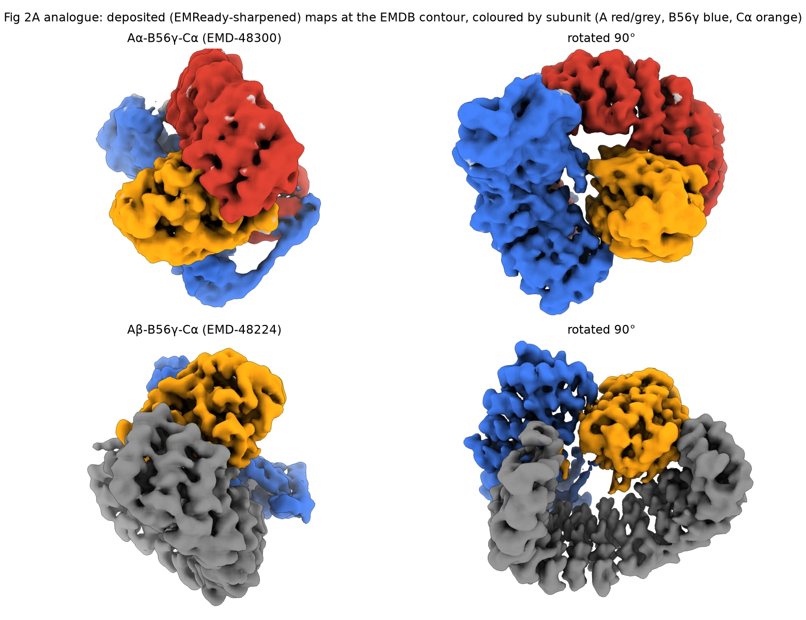

**Reproduction in detail** (*draft deck*, cut from the final presentation for time). I re-analysed the deposited maps and models: Aα–B56γ–Cα (EMD-48300, PDB 9MIP) and Aβ–B56γ–Cα (EMD-48224, PDB 9MF5).

*Step 1: quality control.* I re-analysed the half maps with three tools and checked the deposited models:

| Quantity | Paper Aα | Mine, Aα | Paper Aβ | Mine, Aβ | How |
|---|---|---|---|---|---|
| Map resolution, FSC 0.143 (Å) | 3.4 | 3.42 (deposited curve) · 3.50 (CryoSPARC v5) · 3.50 (Phenix) · 3.54 (RELION, loose mask) | 3.2 | 3.22 · 3.33 · 3.34 · 3.33 | half maps re-analysed with three tools |
| Model resolution, FSC 0.5 (Å) | 3.8 | 3.80 | 3.6 | 3.63 | phenix.mtriage |
| MolProbity score / clashscore | 1.25 / 4.88 | 1.25 / 4.88 | 1.15 / 3.59 | 1.15 / 3.59 | phenix.molprobity on the deposited models |
| Ramachandran favoured / allowed / outliers (%) | 98.08 / 1.92 / 0 | 98.08 / 1.92 / 0 | 98.22 / 1.78 / 0 | 98.22 / 1.78 / 0 | |
| RMS bonds (Å) / angles (°) | 0.010 / 1.291 | 0.0102 / 1.29 | 0.009 / 1.241 | 0.0089 / 1.24 | |

I also produced RELION 3.1 local-resolution maps (3.0–5.0 Å), as in their Fig. S5.

*Step 2: density map to atomic model.* I reproduced:

- the Fig. 2A maps, coloured by subunit at the EMDB contour;
- the Fig. 2B 6 Å low-pass half-map averages showing the B56γ C-terminal helix (9MIP B402–436).

For our project, the same comparison looks for **spring attachment** rather than for A–B interface interactions.

*Step 3: A-subunit deformation.* I superposed the A subunits on HEAT 12–15 Cα and compared the centres of mass of each HEAT repeat:

| Quantity | Paper Aα | Mine, Aα | Paper Aβ | Mine, Aβ |
|---|---|---|---|---|
| HEAT1–HEAT15 centroid distance (Å) | 62.7 | 63.3 | 59.6 | 60.4 |
| HEAT3–HEAT5 salt bridge, Cα–Cα (Å) | 13.2 (R113–E191) | 12.7 | 12.4 (R125–E203) | 12.4 |
| Interface residues within 4 Å of B56γ / Cα | 11 / 11 | 11 / 11 | 11 / 11 | 11 / 11 |

The relevance for us: instead of two isoforms, compare **Aα WT vs Aα with a 50 nt spring attached**.

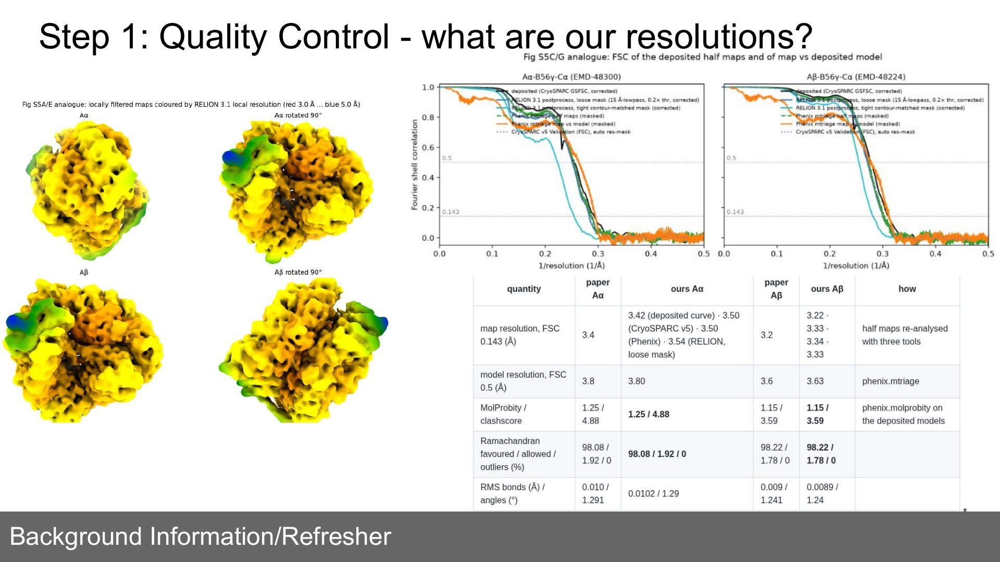

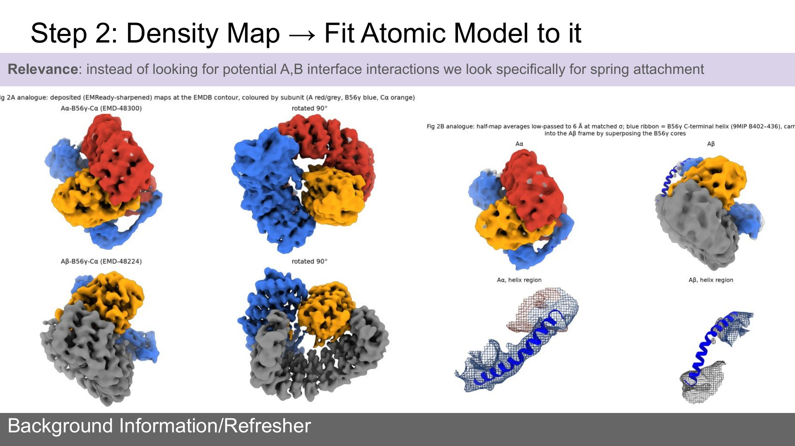

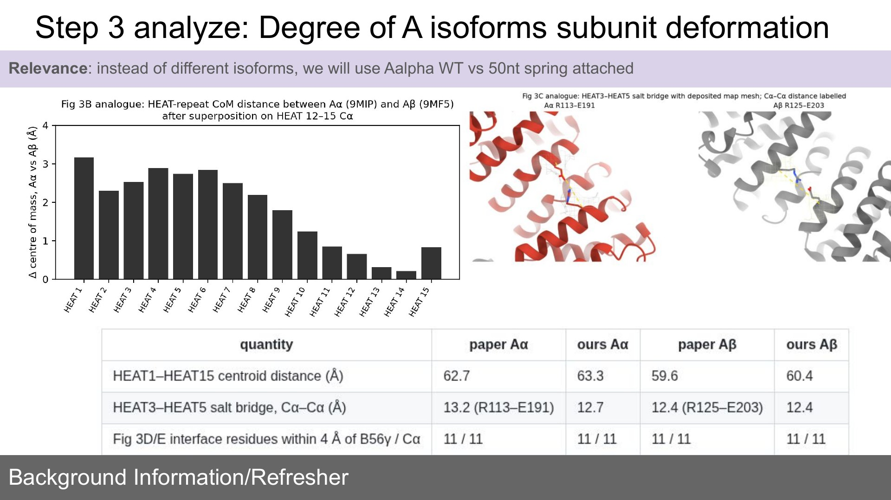

### 4.2 How cryoEM analysis differs from X-ray crystallography [S44]

| | X-ray crystallography | cryoEM |
|---|---|---|
| Radiation | diffracted X-ray photons | scattered and transmitted electron waves |
| 3D reconstruction | recover the missing Fourier **phases** → electron-density map | recover the particle **orientations** → electrostatic-potential map |
| Refinement | reciprocal space: adjust atoms to match the measured diffraction intensities | real space: adjust atoms to fit the reconstructed 3D map |

Both methods end by fitting an atomic model into a reconstructed 3D map.

The draft deck laid the two pipelines side by side:

- **X-ray:** diffraction images → spot finding → indexing and integration → scaling and merging → phasing → electron-density map → atomic model building → reciprocal-space refinement → validation.
- **cryoEM:** electron movies → motion and CTF correction → particle picking → 2D classification → 3D reconstruction → 3D classification and refinement (CryoSPARC, TOPAZ) → 3D density map → atomic model building → real-space refinement → validation (RELION, EMReady, COOT).

**Key differences.**

- *Phases.* Both techniques measure intensities, not phases. In X-ray crystallography the Fourier phase information is lost in the diffraction intensities. cryoEM instead uses **electron-wave interference to encode phase information into image intensity contrast**.
- *Orientations.* Proteins in X-ray crystals form an ordered lattice, while individual proteins in cryoEM lie in **random orientations in vitreous ice**. So cryoEM must computationally **estimate particle orientations** to reconstruct a 3D map, whereas X-ray crystallography mainly needs to recover the missing Fourier phases.

The aim of the theory section was to explain, intuitively, how CryoSPARC gets from 2D images to a 3D density map. Crystallographers can draw parallels through diffraction and Fourier space [S45 intro].

### 4.3 Image formation: how an almost invisible protein gives contrast

#### Defocus [S45]

- In a thin lens, $1/f = 1/s + 1/s'$, with the object and sensor fixed.
- A stronger lens (shorter $f$) makes the rays cross before the sensor and spread into a disc.
- A weaker lens (longer $f$) makes them meet beyond the sensor, again giving a disc. In the TEM this is **underfocus**.
- The objective-lens current sets $f$, so the focus knob moves the focus by $\Delta f$. cryoEM images are taken **deliberately ≈ 0.5–3 µm out of focus**.

#### Effect 1: phase and amplitude [S46]

- An **amplitude object** absorbs electrons, so the image is darker there.
- A **phase object** keeps the amplitude but delays the wave by $\phi$.
- A protein in ice is made of light atoms (C, N, O, H). It is almost a pure phase object, barely absorbing 300 keV electrons, so the detector records $|\psi|^2 = |e^{i\phi}|^2 = 1$. **In focus, the protein is nearly invisible.**

#### Effect 2: scattering, i.e. diffraction [S47]

- A repeat of spacing $d$ scatters the wave by $\alpha \approx \lambda/d$ (Bragg: $2d\sin\theta = \lambda$, with $\alpha = 2\theta$).
- Finer detail scatters further, so the direction encodes the **spatial frequency $q = 1/d$**.
- The objective lens sends each direction to one point of its back focal plane, so fine detail lands far from the centre.
- At 300 kV ($\lambda$ = 0.0197 Å), even 3 Å detail scatters by only ≈ 0.4°.

#### The weak phase object approximation (WPOA) [S48]

We saw that a phase shift makes the protein invisible to an intensity detector. Two questions follow: *how is that so*, and *how much is the scattered wave shifted relative to the unscattered wave*? The analysis simplifies greatly once we know the shift is **small**.

- Incident plane wave: $\Psi_{in}(\mathbf r, z) = e^{ikz}$, with $k = 2\pi/\lambda$.
- Exit wave: $\Psi_{exit}(x,y) = e^{i\phi(x,y)}$. With $|\phi| \ll 1$,
  $$\Psi_{exit} \approx 1 + i\phi(x,y)$$
  Here 1 is the unscattered reference and $i\phi$ is the scattered wave.
- Since $i = e^{i\pi/2}$, the scattered wave is **in quadrature (90° out of phase)** with the reference.
- Intensity: $I_{exit} = |1 + i\phi|^2 = 1 + \phi^2 \approx 1$. For $\phi$ = 0.2 rad this is 1.04. The exit wave is as bright as the reference, so **the protein gives no contrast**.

#### Key principle: defocus turns phase shifts into contrast [S49]

Changing the defocus changes the relative phase between the scattered and unscattered waves, and that creates the contrast. This is the same idea as a Zernike phase plate in light microscopy.

| Scattered wave relative to the reference | Exit-wave intensity | To first order in $\phi$ |
|---|---|---|
| antiparallel (extra phase $\chi = \pi/2$): particle **dark** | $(1-\phi)^2 = 1 - 2\phi + \phi^2$ | $1 - 2\phi$ |
| parallel ($\chi = 3\pi/2$): particle **bright** (contrast reversed) | $(1+\phi)^2 = 1 + 2\phi + \phi^2$ | $1 + 2\phi$ |
| perpendicular (in focus) | $\lvert 1+i\phi\rvert^2 = 1 + \phi^2$ | $1$ |

Under the WPOA, $\phi^2 \approx 0$ but $2\phi$ is not. Only the parallel and antiparallel cases move the intensity away from unity; at 90° the change is second order and invisible.

In general the contrast is ≈ $-2\phi\sin\chi$. So **$\sin\chi$ is the contrast transfer function (CTF)**, largest at $\chi = \pi/2 + k\pi$. Defocus supplies
$$\chi(q) = \pi\lambda\Delta f\,q^2 - \tfrac12\pi C_s\lambda^3q^4$$
which is a different extra phase for every spatial frequency.

#### Where the defocus phase comes from: the Fresnel propagator [S50]

1. **Scattering tilts the wave.** A plane wave $\psi(\mathbf r) = e^{i\mathbf k\cdot\mathbf r}$ scattered by detail of frequency $\mathbf q$ gains a transverse wavevector $\mathbf k_\perp = 2\pi\mathbf q$.
2. **Elastic scattering keeps $|\mathbf k| = k_0 = 2\pi/\lambda$.** For small angles ($\lambda q \ll 1$):
   $$k_z = \sqrt{k_0^2 - (2\pi q)^2} \simeq k_0 - \pi\lambda q^2$$
3. **Propagation.** Over a distance $z$, each component gains $e^{ik_z z}$. Dropping the common carrier phase gives the **Fresnel propagator**:
   $$H_z(q) = e^{-i\pi\lambda z q^2}$$
4. **Defocus.** Recording the wave $\Delta f$ from focus (underfocus: $z = -\Delta f$) gives every $q$ its own extra phase, $\chi_{def}(q) = \pi\lambda\Delta f\,q^2$. Spherical aberration adds $-\tfrac12\pi C_s\lambda^3 q^4$.

Positive $\Delta f$ means underfocus here; sign conventions differ between texts.

#### The CTF in practice [S51]

These points use CTF$(q) = \sin\chi(q)$, computed for 300 kV and $C_s$ = 2.7 mm:

- **Zeros:** the image carries no information at those $q$.
- **Negative lobes:** contrast is reversed.
- At $q \to 0$ the CTF → 0 too, so the particle's overall shape is weak.
- **More defocus:** stronger low-resolution contrast and faster oscillation at high $q$.
- **A range of defocus values** (e.g. 0.9, 1.2, 1.7, 2.6 µm) puts the zeros at different $q$, so every $q$ is measured somewhere. CTF correction flips the negative lobes back and weights each $q$ by how well it was seen.
- **An envelope** (beam incoherence, drift, radiation damage) damps high $q$. That is why high resolution needs many averaged particles.

### 4.4 The forward model: from the 3D molecule to each recorded image [S52–S55]

The key theoretical model behind 3D structure determination from 2D images:

$$\text{(41)}\qquad (P_{R_i}V)(x,y) = \int V\big(R_i^{-1}(x,y,z)\big)\,dz$$

$$\text{(42)}\qquad Y_i(\mathbf q) = C_i(\mathbf q)\;\tilde V\big(R_i^{\mathsf T}(q_x,q_y,0)^{\mathsf T}\big)\;e^{-2\pi i\,\mathbf q\cdot\mathbf t_i} + N_i(\mathbf q)$$

| Term | Meaning |
|---|---|
| $V(\mathbf r)$ | the 3D **specimen (scattering) potential**, the electrostatic potential that scatters the electrons, at every point $\mathbf r = (x,y,z)$; the map we want |
| $i$ | the particle index, $i = 1,\dots,N$ (typically $10^5$–$10^6$ particles) |
| $R_i$ | a 3 × 3 **rotation matrix**: the orientation particle $i$ happens to have in the ice. $R_i^{-1}$ maps a microscope-frame point back into the molecule's frame |
| $(x,y),\ z$ | detector coordinates, and the beam direction (optic axis) |
| $P_{R_i}V$ | the **projection**: $V$ summed along each straight electron path, one value per pixel |
| $\mathbf q = (q_x,q_y)$ | 2D spatial frequency (Å⁻¹); detail of size $d$ sits at $\lvert\mathbf q\rvert = 1/d$ |
| $\tilde V$ | the 3D Fourier transform of $V$. On the tilted plane $R_i^{\mathsf T}(q_x,q_y,0)^{\mathsf T}$ it is a **central slice** |
| $C_i(\mathbf q)$ | the **CTF** of image $i$, a transfer function that multiplies each frequency |
| $\mathbf t_i = (t_x,t_y)$ | in-plane **translation**: particle $i$ is not exactly centred in its box. In Fourier space it is a **phase ramp**, $e^{-2\pi i\mathbf q\cdot\mathbf t_i}$, and the magnitude is unchanged |
| $N_i(\mathbf q)$ | **noise**: mostly shot noise from the low electron dose, plus the ice |
| $Y_i(\mathbf q)$ | the 2D Fourier transform of the **recorded particle image** $i$ |

**The CTF as a transfer function.** The lens acts on the electron *wave* in Fourier space, $\tilde\psi_{image} = H_i\,\tilde\psi_{exit}$, with
$$H_i(\mathbf q) = e^{-i\chi_i(q)} = \exp\!\big(-i\pi\lambda\Delta f_i q^2 + \tfrac{i}{2}\pi C_s\lambda^3q^4\big)$$
The detector records *intensity*. For a weak phase object, $\tilde I(\mathbf q) \approx \delta(\mathbf q) + 2\sin\chi_i(q)\,\tilde\sigma(\mathbf q)$, so only $C_i = -\mathrm{Im}\,H_i = \sin\chi_i$ acts on the specimen.

**In one sentence:** eq. (42) models the **projection of the 3D volume** onto every 2D image. It rotates ($R_i$), projects, filters by the CTF ($C_i$), shifts ($\mathbf t_i$) and adds noise ($N_i$).

- **Known:**
  - $Y_i$, from each recorded particle image;
  - $C_i$, computed from $\chi(q)$ with the defocus fitted to each micrograph.
- **Unknown, i.e. the goal:**
  - the **pose** $(R_i, \mathbf t_i)$ of every particle;
  - the map $V$, into which atomic models are fitted.

#### Projection and orientation [S53]

- The beam integrates the 3D potential along $z$, so **one view cannot fix depth**.
- For a beam from another direction, the detector frame rotates to $x', y', z'$. The rotation $R$ turns the particle so that we always integrate along the beam.
- In a real sample, particles sit in the ice in every orientation. The beam effectively strikes each one from a different direction, so **each image needs its own $R$**.

This slide used my own Manim animation and the CryoSPARC guide's orientation animation.

#### Central slice theorem [S54]

Why work in Fourier space? Because the CTF adds a different phase shift at each spatial frequency.

1. **Projection.** $(P_RV)(x,y) = \int V\big(R^{\mathsf T}(x,y,z)^{\mathsf T}\big)\,dz$
2. **3D transform.** $\tilde V(k_x,k_y,k_z) = \iiint V\,e^{-2\pi i(k_xx+k_yy+k_zz)}\,dx\,dy\,dz$
3. **2D transform of a projection** (beam along $z$). The exponential does not depend on $z$, so it moves inside the $z$-integral:
   $$\mathcal F_2\{PV\}(q_x,q_y) = \tilde V(q_x,q_y,0)$$
4. **Any orientation** simply rotates the plane:
   $$\mathcal F_2\{P_RV\}(\mathbf q) = \tilde V\big(R^{\mathsf T}(q_x,q_y,0)^{\mathsf T}\big)$$

**Consequence.**

- Every particle image fills one **central plane** of $\tilde V$.
- Many orientations fill the 3D Fourier volume, and an inverse 3D transform returns $V$.
- Orientations clustered around one axis leave a **missing cone**, and the map stretches along the missing direction (**preferred orientation**).

#### The CTF, shift and noise terms [S55]

- **CTF.** In Fourier space the projection is simply **multiplied** by $C_i(\mathbf q)$:
  - positive lobes pass a frequency;
  - negative lobes flip its sign;
  - zeros erase it.
- **Two Fourier properties:**
  - shift: $\mathcal F[g(\mathbf x-\mathbf t)] = e^{-2\pi i\mathbf q\cdot\mathbf t}\,\tilde g(\mathbf q)$;
  - convolution: $\mathcal F[h*g] = \tilde h\,\tilde g$.

  The microscope's point-spread function $h$ blurs the image in real space. That blur is a product in Fourier space, with $\tilde h = C_i$.
- **Shift.** $e^{-2\pi i\mathbf q\cdot\mathbf t_i}$ is just the in-plane shift of the particle in its box. The **pose $(R_i, \mathbf t_i)$** is five numbers per particle: three angles for the orientation relative to the beam, and two for the position.
- **Noise.** $N_i(\mathbf q) \sim \mathcal N(0, \sigma_i^2(q))$: zero-mean Gaussian, independent at each frequency, with a variance that may depend on $|\mathbf q|$, as assumed throughout the literature (e.g. RELION). This is reasonable because each Fourier coefficient sums over many pixels (central limit theorem), even though electron counts are Poisson.

### 4.5 Reconstruction [S56–S59]

#### Known poses (1/2): a linear Gaussian model [S56]

How do we recover $V$ in practice? First assume the poses are known. Then the forward equation in real space, with the voxels of $V$ stacked into a vector $\mathbf v$, is **linear**:
$$\underbrace{\mathbf y_i}_{\mathcal F_2^{-1}[Y_i]} = \underbrace{A_i\mathbf v}_{\mathcal F_2^{-1}[C_i\tilde V(\cdot)e^{-2\pi i\mathbf q\cdot\mathbf t_i}]} + \underbrace{\boldsymbol\varepsilon_i}_{\mathcal F_2^{-1}[N_i]}$$
Here $A_i$ is a fixed $m \times n$ matrix (rotate, project, shift, CTF-filter) for $m$ pixels and $n$ voxels.

1. **Residual.** The residual $\mathbf y_i - A_i\mathbf v$ is the image minus its prediction. If $\mathbf v$ is the true map, the residual is exactly the noise: $\boldsymbol\varepsilon_i \sim \mathcal N(\mathbf 0,\Sigma_i)$.
2. **One pixel.** $p(\varepsilon) = \frac{1}{\sqrt{2\pi\sigma^2}}e^{-\varepsilon^2/2\sigma^2}$, so a measurement $y = \mu + \varepsilon$ has $p(y\mid\mu) = \frac{1}{\sqrt{2\pi\sigma^2}}e^{-(y-\mu)^2/2\sigma^2}$.
3. **$m$ independent pixels.** Multiplying the densities gives $(2\pi)^{-m/2}|\Sigma|^{-1/2}\exp[-\tfrac12(\mathbf y-\boldsymbol\mu)^{\mathsf T}\Sigma^{-1}(\mathbf y-\boldsymbol\mu)]$. This form also covers correlated pixels.
4. **Likelihood of image $i$.** Set $\boldsymbol\mu = A_i\mathbf v$:
$$p(\mathbf y_i\mid\mathbf v) = \frac{1}{(2\pi)^{m/2}|\Sigma_i|^{1/2}}\exp\Big[-\tfrac12(\mathbf y_i-A_i\mathbf v)^{\mathsf T}\Sigma_i^{-1}(\mathbf y_i-A_i\mathbf v)\Big]$$

The exponent is the noise-weighted squared residual, and $\mathbf v$ enters only through it.

#### Known poses (2/2): the normal equations [S57]

1. **Independent images.** The $N$ images are independent given $\mathbf v$, so the joint likelihood is the product of the individual likelihoods.
2. **Take the log.** The log turns the product into a sum, which avoids the numerical underflow of multiplying thousands of tiny probabilities. The misfit to minimise is
   $$L(\mathbf v) = \tfrac12\sum_i(\mathbf y_i-A_i\mathbf v)^{\mathsf T}\Sigma_i^{-1}(\mathbf y_i-A_i\mathbf v)$$
   This is a noise-weighted least-squares problem.
3. **Set the gradient to zero.** With $\nabla_{\mathbf v}L = \sum_iA_i^{\mathsf T}\Sigma_i^{-1}(A_i\mathbf v-\mathbf y_i)$, setting it to $\mathbf 0$ gives the **normal equations**:
$$\Big(\sum_{i=1}^{N}A_i^{\mathsf T}\Sigma_i^{-1}A_i\Big)\hat{\mathbf v} = \sum_{i=1}^{N}A_i^{\mathsf T}\Sigma_i^{-1}\mathbf y_i$$

How to read them:

- **Right-hand side:** every image back-projected into 3D ($A_i^{\mathsf T}$), weighted by its noise.
- **Left-hand side:** how often each part of $\mathbf v$ was measured.

Solving divides one by the other. One image measures a single central line or plane. Low frequencies are measured by every image and high frequencies by few, so frequencies that were never measured cannot be recovered by averaging.

#### Unknown poses: alternate poses and map [S58]

Now both the map and every pose $\phi_i = (R_i,\mathbf t_i)$ are unknown:
$$\min_{\mathbf v,\phi_1..\phi_N}\ \tfrac12\sum_i\big\|\mathbf y_i - A(\phi_i)\mathbf v\big\|^2_{\Sigma_i^{-1}}$$
$A(\phi)$ is nonlinear in the pose, so there is no closed-form solution. Instead:

1. **Start** from an initial volume $\mathbf v^{(0)}$: ab initio, or a low-pass filtered reference.
2. **Pose step.** Hold the map and give each image its best pose, $\phi_i^{(k)} = \arg\min_{\phi\in SO(3)\times\mathbb R^2}\|\mathbf y_i - A(\phi)\mathbf v^{(k)}\|^2$.
3. **Map step.** Hold the poses and solve the known-pose normal equations for $\mathbf v^{(k+1)}$.
4. **Stop** when $L$ no longer decreases.

Neither step can raise $L$, so the loop converges, but only to a **local optimum that depends on $\mathbf v^{(0)}$**. RELION and CryoSPARC soften the pose step: they weight every pose by its probability (**expectation–maximisation**) instead of keeping only the best one.

#### The loop in action [S59]

I demonstrated the loop with a 2D toy: 100 simulated images of one object, each rotated by an unknown angle and buried in heavy noise, with alignment computed live.

1. Start from a blurred blob.
2. **Pose step:** compare each image with the map rotated through every angle in 5° steps; the best match is its pose.
3. **Map step:** rotate the images back and average them. The new map is already far clearer than any single image.
4. **Repeat:** the **mean pose error falls from 22° to ≈ 2° within two iterations**.

The result matches the truth up to an overall rotation, which the images alone can never fix. A poor starting map can trap the loop in a local optimum.

### 4.6 In practice: CryoSPARC on real actin-filament micrographs [S60]

To show the whole workflow end to end, I used a past project of mine: recovering 3D maps from **real micrograph particle images of actin filaments**. Actin filaments are a natural proxy for force-transducing DNA strands.

**Job J1, Import Particle Stack:**

- Loaded **5,000 particles** from a `.star` file into one output group. The low-pass filtered previews show straight filament segments lying in every in-plane direction.
- The warnings say the file has **no orientations** (no rlnAngleRot/Tilt/Psi). The poses $(R_i,\mathbf t_i)$ are exactly what must be found.
- The log lists what each particle does carry:
  - a **160 × 160 px box at 5.76 Å/px**;
  - its **CTF parameters** (defocus, amplitude contrast 0.1), so the next job can apply $C_i(\mathbf q)$.

**Job J2, Ab-initio Reconstruction:**

- Used all 5,000 particles, **1 class**, and **no assumed symmetry (C1)**.
- It starts from a random map and alternates pose and map steps, i.e. the loop above.
- By **iteration 900**, the three central slices and the volume preview show a filament, and the log reports a **resolution of ≈ 17 Å**. I stopped the job after **8 min 17 s**, which was enough for a first map.

**Where it ran.** On the **Hekstra lab cluster** from my home directory, with the raw data on netscratch.

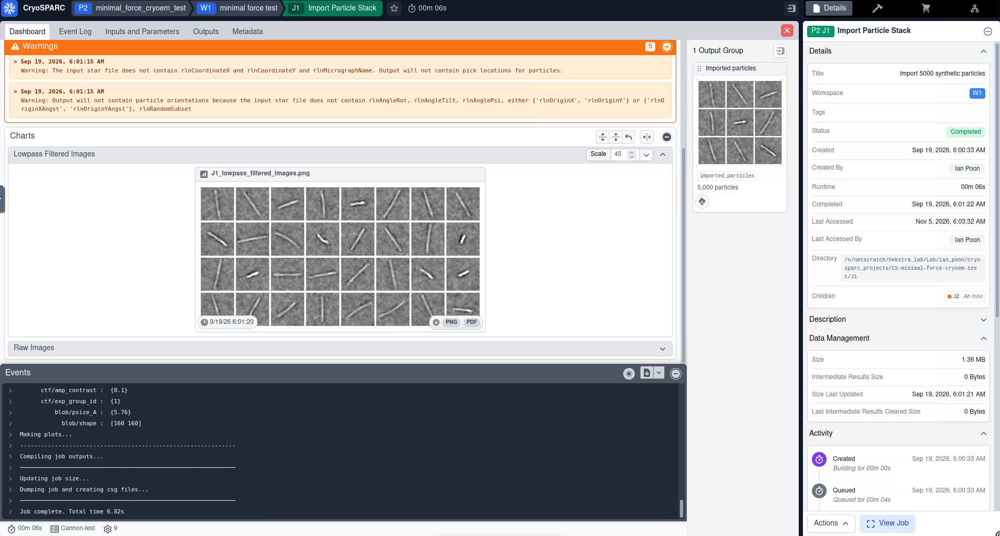

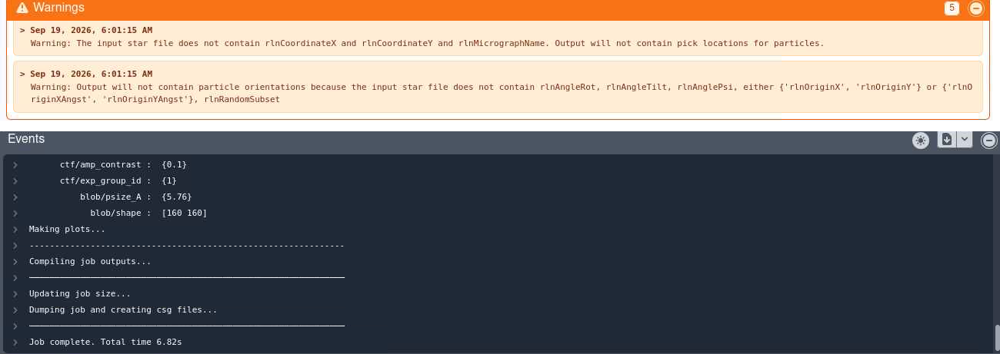

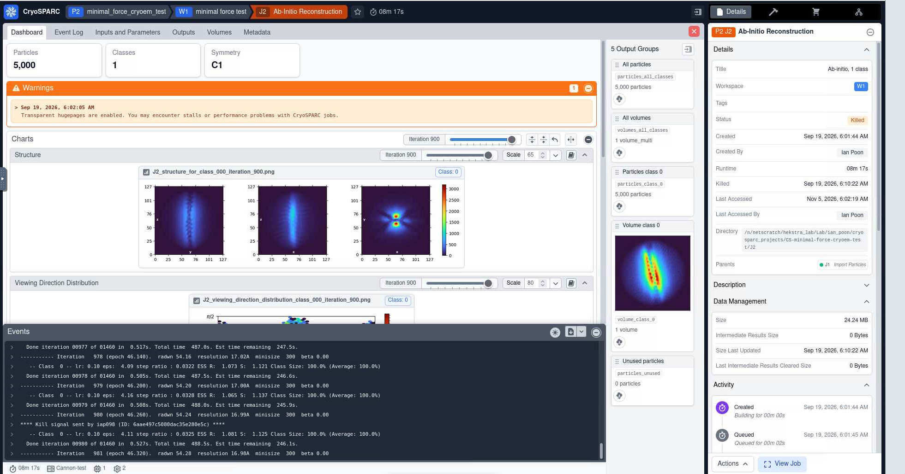

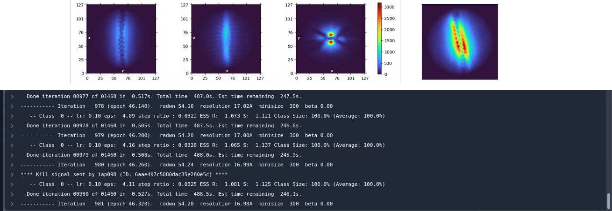

---

## 5. Overall progress, timeline and skills

### 5.1 Where I started [S61]

Four months before this meeting I arrived in the US for the first time in my life. I had practically no relevant wet-lab experience, and was almost a whole globe's circumference away from my home country, Singapore.

I went from learning how to pipette to:

- purifying proteins with resins and size-exclusion columns;
- preparing cryoEM grids;
- running fluorometry experiments;
- making gels;
- growing cell cultures for plasmid transformation, and other assays.

### 5.2 Key achievements

1. **The first circular PP2A–DNA spring chimera in the Hekstra lab.** I got there by optimising the ratio, cleaving the GST tag and lengthening the BCN incubation, and proved it circular with a TCO-resin capture test that I validated with PEG-capped controls [S26–S33, S42].
2. **A high-purity, big-batch circular sfGFP–dsDNA chimera** made by a high-throughput, low-cost route needing no further purification. These samples are now on cryoEM grids [S7, S24, S42].
3. **A validated fluorometry assay.**
   - I defined a concentration-independent metric (the excitation band ratio) and found its valid range (≤ 8–10 µM) from the inner filter effect.
   - I reproduced tetrazine quenching.
   - I tested spring force on ss, ds and nicked chimeras [S8–S12].
4. **An all-atom MD pipeline for DNA-spring chimeras** (4,050 ns; 81 replicates; 17 systems).
   - It showed that sfGFP's barrel and chromophore are insensitive to the spring, which explains the fluorometry result.
   - It reconciled the MD force field with Zocchi's DNA-spring model: they agree within 1.1–1.2× once the model's kinking condition is removed [S13–S23].
5. **A cryoEM downstream workflow (CryoSPARC), new to the lab.**
   - I reproduced the resolution, validation and deformation statistics of a published PP2A holoenzyme study.
   - I ran an ab-initio reconstruction from real actin-filament particles (≈ 17 Å).
   - I taught the theory from image formation to maximum-likelihood reconstruction [S43–S60].
6. **A three-assay plan for PP2A under spring force** (cryoEM, BLI, DiFMUP), with the rationale for why all three are needed [S36–S41].

### 5.3 Timeline

Dates come from the chart titles and slide text. The synthesis and MD work is not dated on the slides.

| When | What |
|---|---|
| ≈ July 2026 | Arrived in the Hekstra lab (four months before the meeting) |
| before mid-August (undated) | sfGFP chimera synthesis: circular-product gel test and the big high-purity batch [S6–S7] |
| 2026-08-12 | Fluorometry, tet quenching, attempt 1 [S11] |
| 2026-08-21 | Tet quenching, attempts 2 and 3 [S11] |
| 2026-08-25 | 1-tet concentration series and ladder: band-ratio validation and inner filter effect [S9–S10] |
| 2026-08-28 | Spring-force fluorometry, two attempts (ss / ds / nicked) [S12] |
| Aug–Oct (undated) | sfGFP MD campaign and spring-force modelling [S13–S23] |
| Sep–Oct (undated) | PP2A synthesis chain: ratio → GST cleavage → 12 h BCN → TCO resin proof → SEC → DTT [S26–S35]. Assay planning [S36–S41] |
| Sep–Oct (undated) | CryoSPARC set-up and reproduction of Day et al.; CryoSPARC tutorial preparation [S43–S60] |
| ≈ 2026-10-27 | Grid-screening session postponed (microscope breakdown). sfGFP grids loaded by Micheal from my samples [S42, S43] |
| 2026-10-29 | Lab meeting (this report) |

### 5.4 Techniques and skills

- **Wet lab:**
  - pipetting and solution preparation;
  - SDS-PAGE with protein and DNA stains;
  - bioorthogonal click conjugation (tetrazine with TCO/BCN) and DNA hybridisation;
  - protein purification with resins and size-exclusion chromatography;
  - thrombin titration to remove a GST tag;
  - TCO-resin capture with PEG-capping controls;
  - disulfide reduction with DTT and desalting;
  - cell culture and plasmid transformation;
  - cryoEM grid preparation.
- **Spectroscopy:**
  - steady-state fluorometry on a HORIBA Fluorolog-3 (excitation and emission spectra, lamp correction);
  - designing a concentration-independent metric;
  - diagnosing the inner filter effect.
- **Computation:**
  - all-atom MD of protein–DNA chimeras;
  - trajectory analysis: RMSF, Ramachandran plots, H-bond occupancy with mdtraj, DNA bend profiles, force from restraint stretch;
  - analytical DNA mechanics (Zocchi's buckling and kink model);
  - HPC on the lab cluster.
- **Structural biology:**
  - cryoEM image-formation theory (WPOA, CTF, Fresnel propagation);
  - the forward model and the central slice theorem;
  - maximum-likelihood reconstruction;
  - CryoSPARC (import, ab initio);
  - map and model validation with CryoSPARC, RELION, Phenix (mtriage, molprobity) and EMReady.
- **Communication:** a 61-slide lab-meeting presentation with animated gel walkthroughs, theory explainers and my own Manim animation.

My draft deck also listed three techniques new to the lab that I troubleshot independently:

- the MD set-up for DNA-spring chimeras;
- fluorometry data collection;
- downstream cryoEM analysis in CryoSPARC.

It planned GitHub documentation for CryoSPARC set-up and for efficient cluster (fair-share) usage.

### 5.5 Acknowledgements [S61]

None of this would have been possible without the kind guidance of everyone in the Hekstra lab, especially **Micheal Schnebly** and **Doeke Hekstra**. I am glad to have reached new milestones in this DNA-spring chimera project in such a short time, and I hope more promising PP2A results follow in the year to come.

---

## 6. Open problems and next steps

**PP2A synthesis and purification**

1. **SEC dilution.** The circular product spreads over the SEC fractions and becomes too dilute to see [S33]. Next:
   - concentrate the fractions on a His-tag (affinity) column;
   - or find a concentrator compatible with our small volumes.
2. **DTT window.** DTT is needed to stop disulfide-linked dimers, but the DTT carried over after desalting inhibits the click [S35]. Next:
   - find the minimum DTT that still reduces the disulfides (≈ 1–10 mM in the dye test);
   - improve DTT removal before adding the DNA.
3. **Scale-up** to a purified batch big enough for all three assays [S42].

**PP2A assays**, once a purified batch exists [S38–S42]:

- **BLI:** $K_D$ of B56 for Aα(+spring)–C vs WT Aα–C.
- **DiFMUP:** $K_M$ and $V_{\max}$ of the holoenzyme with vs without the spring.
- **cryoEM:** confirm spring attachment, and measure HEAT-repeat centre-of-mass shifts after aligning on HEAT 12–15, using the pipeline I have already validated on Day et al.'s maps.

**PP2A MD** [S42]

- Build the tet-TCO/BCN pp2a chimera systems. pp2a is expected to respond far more to spring force than sfGFP.

**sfGFP** [S23, S42, S43]

- Image the sfGFP grids once the microscope is repaired, and run the CryoSPARC workflow live on our own chimera data.
- At these forces sfGFP is not force-sensitive. Seeing an effect would need a softer attachment site or a far stronger spring.

**Open physics question** [S22]

- Does a bent DNA duplex kink at 4.8–5.2°/bp? Zocchi's model says yes, so a few pN would reach the protein. The force field says no, so tens of pN would. Experiment has to decide which force our springs really deliver.

**Tools and documentation** [S43]

- Publish the CryoSPARC set-up tutorial on GitHub.
- Consider open-source or custom cryoEM tools in the spirit of the lab's X-ray software.

---

## Appendices

### Appendix A. Glossary

| Term | Meaning |
|---|---|
| Tet, Tet2-Et | tetrazine-bearing unnatural amino acid placed at the attachment sites |
| 1-tet / 2-tet | protein with one or two Tet sites. 1-tet can only form linear chimeras (control); 2-tet can circularise |
| TCO, BCN, sTCO | strained-alkene and alkyne click partners of tetrazine, carried at both ends of the ssDNA |
| cDNA | complementary DNA strand. Hybridising it turns ssDNA into a stiff dsDNA spring |
| ss / ds / nicked spring | single-stranded (floppy) / double-stranded (stiff, pushes) / ds with one backbone break (softer) |
| linear chimera | DNA attached at one end only |
| circular chimera | both DNA ends on the same protein (1 : 1), i.e. the product of interest |
| 2 : 2 ring | two proteins and two DNA strands closed into a ring: the unwanted circular product for PP2A |
| bridged species | one DNA strand linking two proteins (2 protein + 1 DNA) |
| GST, thrombin | affinity tag on the pp2a constructs, and the protease used to remove it |
| TCO resin | TCO-coated beads that trap any protein with a free Tet. Circular products pass through |
| PEG capping | blocking Tet groups with TCO-PEG, a cheap stand-in for DNA when testing the resin |
| SEC | size-exclusion chromatography |
| DTT, BME | reducing agents. DTT breaks the disulfide bonds that stick pp2a molecules together |
| band ratio | $I(400)/I(\text{peak})$ on the lamp-corrected excitation spectrum: a concentration-independent fluorometry metric |
| inner filter effect | absorption of the excitation light by a concentrated sample before it reaches the observed volume |
| RMSF | root-mean-square fluctuation of each residue about its mean position |
| $B$, $\tau_c$ | DNA bending stiffness (≈ 200 pN nm²); critical torque at which one base-pair step kinks (34 pN nm, or 27 if nicked) |
| $\gamma$, $x_c$ | Zocchi's kink parameter $L\tau_c/2B$; the end-to-end distance below which the model rod kinks |
| Euler load | push of an unkinked buckled rod, $\pi^2B/L^2$ |
| HEAT repeat | helix–turn–helix unit. PP2A A is a horseshoe of 15 of them |
| AC core, ABC holoenzyme | A + C dimer; A + B + C complex |
| BLI, $K_D$ | biolayer interferometry; dissociation constant $k_{off}/k_{on}$ |
| DiFMUP, $K_M$, $V_{max}$ | fluorogenic phosphatase substrate; Michaelis–Menten constants |
| WPOA | weak phase object approximation, $e^{i\phi} \approx 1 + i\phi$ |
| CTF, $\chi(q)$, $\Delta f$, $C_s$ | contrast transfer function $\sin\chi$; defocus phase; defocus; spherical aberration |
| pose $(R_i,\mathbf t_i)$ | orientation and in-plane shift of particle $i$ (5 numbers) |
| central slice theorem | the 2D transform of a projection is a central plane of the 3D transform |
| FSC | Fourier shell correlation, used for resolution (0.143 for map vs map, 0.5 for map vs model) |
| ab initio, C1 | reconstruction from a random start; no assumed symmetry |

### Appendix B. Experimental conditions at a glance

| Experiment | Key conditions |
|---|---|
| Fluorometer | HORIBA Jobin Yvon Fluorolog-3. Excitation scan 400–500 nm detected at 510 nm; emission scan 500–600 nm excited at 485 nm. S1 ÷ R1 lamp correction. 3 scans per sample |
| Band-ratio validation | 1-tet sfGFP at 2, 4, 8, 16 and 32 µM (2026-08-25). Flat to 8 µM; all later readings ≤ 10 µM |
| Tet quenching | 0/1/2-tet sfGFP. Attempt 1 ≈ 4 µM (estimated); attempt 2 at 8/10/10 µM; attempt 3 at 1.3/3.3/1.5 µM |
| Spring force | ss / ds / nicked sfGFP chimeras at 10 µM, two attempts (2026-08-28) |
| sfGFP MD | 4,050 ns, 81 replicates, 17 systems. Sites Asp133/Asn149 (31.3 Å apart). Springs 27 bp and 40 bp (intact and nicked). Force clamp 0–20 pN, 3 replicates. Bare-duplex force runs: 25 / 10 / 10. Repository: OpenMM, ff14SB + OL15 + TIP3P, 150 mM NaCl, 300 K |
| PP2A ratio optimisation | 2-tet pp2a 4.0 µM. 2-TCO ssDNA 50 or 80 nt at 1.0 / 2.0 / 4.0 µM (1 : 4, 1 : 2, 1 : 1). cDNA 1.3 / 2.5 / 5.0 µM |
| GST cleavage | thrombin 0, 0.01, 0.05, 0.10, 0.25, 0.50 U |
| BCN incubation | 2 h (standard) vs 12 h. 12 h also compared BCN with TCO DNA |
| TCO resin | 25 µL packed resin; packed resin : sample 1 : 1 to 1 : 4. PEG-capped and exposed-Tet controls |
| SEC | resin-treated products; fractions F1–F6 checked by gel |
| DTT, disulfide test | 0, 0.01, 0.1, 1, 10 mM DTT in 6× loading dye, vs BME 2× dye |
| DTT, click test | 0, 8, 16, 20 mM DTT, then desalting, DNA and cDNA. Plus a 0 mM, no-cDNA control |
| BLI (planned, after Day et al.) | AR2G tip with amine-coupled B56. AC core 31–500 nM. 1 : 1 fit |
| DiFMUP (planned, after Day et al.) | 20 nM AC core + 200 nM B56γ. DiFMUP 2–128 µM in triplicate. DiFMU excitation 358 nm, emission 455 nm |
| CryoSPARC demo | 5,000 actin-filament particles (real micrographs). 160 px box, 5.76 Å/px, amplitude contrast 0.1. Ab initio, 1 class, C1; iteration 900; ≈ 17 Å; 8 min 17 s |

### Appendix C. Slide map

Final deck: <https://claude.ai/artifact/3WwWoCorh1GgpnCWQCaTWn> (private; share it from the page's Share menu).

| Slide | Title | Report section |
|---|---|---|
| 1 | Lab Meeting 261029 | Front matter |
| 2 | Why attach DNA springs to proteins? | §1.1 |
| 3 | Three kinds of DNA spring, and why we need all three | §1.2 |
| 4 | For each protein studied, we seek “SAM” | §1.3 |
| 5 | sfGFP initial progress and open problems | §2.1 |
| 6 | sfGFP: how do we identify circular products? | §2.2 |
| 7 | Big batch high purity | §2.2 |
| 8 | Fluorometry: do the tet groups or spring tension change fluorescence? | §2.3 |
| 9 | What the band ratio measures | §2.3 |
| 10 | Concentration ladder - inner filter effect | §2.3 F-1 |
| 11 | Effect of Tet quenching - tet addition dims excitation peak | §2.3 F-2 |
| 12 | Effect of force application | §2.3 F-3 |
| 13 | What is MD analysis? How? | §2.4.1 |
| 14 | sfGFP MD: the protein and the simulated systems | §2.4.2 |
| 15 | sfGFP: Ramachandran plots at the modified sites | §2.4.3 |
| 16 | sfGFP: backbone rigidity (RMSF) | §2.4.4 |
| 17 | sfGFP: forces applied, force field vs model | §2.4.5 |
| 18 | Kinked vs unkinked DNA: how the shape sets the force | §2.4.6 |
| 19 | The set-up behind the force plots: a bare DNA duplex | §2.4.7 |
| 20 | sfGFP: DNA dynamics | §2.4.8 |
| 21 | Why Zocchi’s model puts our springs in the kinked regime | §2.4.9 |
| 22 | sfGFP: kinked vs unkinked regime, and the force field | §2.4.10 |
| 23 | sfGFP: why fluorometry saw no change across ss, ds and nicked | §2.4.11 |
| 24 | Ian’s sfGFP progress summary | §2.5 |
| 25 | PP2A initial progress and open problems | §3.1 |
| 26 | PP2A - wrong circular product + poor yield | §3.2 P-1 |
| 27 | Finding 1: 1 to 1 DNA to protein ratio provides best yield | §3.2 P-2 |
| 28 | Lets cleave GST tag! | §3.2 P-3 |
| 29 | Finding 2: GST cleavage reveals a new band | §3.2 P-4 |
| 30 | Finding 3: longer BCN incubation time = higher yield circular product | §3.2 P-5 |
| 31 | How the TCO resin test works | §3.2 P-6 |
| 32 | So is this new band circular product? Lets use resin to find out! First, check if TCO resin works | §3.2 P-6 |
| 33 | [PENDING] SEC optimization: bands too dilute to be visible | §3.2 P-7 |
| 34 | Why add DTT? Favouring the 1 : 1 circle | §3.2 P-8 |
| 35 | [PENDING] DTT optimization: currently inhibits click chemistry | §3.2 P-9 |
| 36 | PP2A architecture: A, C and B subunits | §3.3.1 |
| 37 | [PENDING] PP2A assays: following Day et al. 2025 | §3.3.2 |
| 38 | [Plans] Holoenzyme formation analysis (cryoEM) | §3.3.3 |
| 39 | [Plans] B56-binding assay: biolayer interferometry (BLI) | §3.3.4 |
| 40 | [Plans] Phosphatase activity assay (DiFMUP) | §3.3.5 |
| 41 | Summary: what each assay tells us about our DNA-spring chimeras | §3.3.6 |
| 42 | Ian’s pp2a progress summary | §3.4 |
| 43 | Setting up cryoEM downstream analysis (new to Hekstra lab) | §4.1 |
| 44 | cryoEM downstream analysis: how it differs from X-ray crystallography | §4.2 |
| 45 | What does it mean to defocus a lens? | §4.3 |
| 46 | Effect 1: the protein shifts the phase AND absorbs amplitude (intensity) | §4.3 |
| 47 | Effect 2: the protein scatters the wave (diffraction) | §4.3 |
| 48 | Key assumption: the weak phase object approximation | §4.3 |
| 49 | Key principle: defocus turns phase shifts into contrast | §4.3 |
| 50 | Where the defocus phase comes from: the Fresnel propagator | §4.3 |
| 51 | Each defocus value gives contrast to different spatial frequencies | §4.3 |
| 52 | The forward model: from the 3D molecule to each recorded image | §4.4 |
| 53 | Projection and orientation: what one particle image records | §4.4 |
| 54 | Central slice theorem | §4.4 |
| 55 | The forward model in Fourier space: CTF, shift and noise | §4.4 |
| 56 | Reconstruction, known poses (1/2): a linear Gaussian model | §4.5 |
| 57 | Reconstruction, known poses (2/2): the normal equations | §4.5 |
| 58 | Reconstruction, unknown poses: alternate poses and map | §4.5 |
| 59 | Reconstruction, unknown poses: the loop in action | §4.5 |
| 60 | In CryoSPARC: from particle images to a 3D map | §4.6 |
| 61 | Acknowledgements | §5.1, §5.5 |

### Appendix D. Figure index

| Folder | Files | What they show |
|---|---|---|
| `figures/schematics/` | `spring_types.svg` | the three spring chimeras (ss, ds, nicked) |
| `figures/gels/` | `p05-sfgfp.jpg`, `p06-bigbatch.jpg` | sfGFP circular-product test; big batch |
| | `p15-pp2a-wrong.jpg` | PP2A baseline (wrong 2 : 2 ring) |
| | `p16-conditions-table.png`, `p16-ratio.jpg` | DNA : protein ratio optimisation |
| | `p17-gst.jpg` | thrombin titration (GST cleavage) |
| | `p18-protein.jpg`, `p18-dna.jpg` | new band after GST cleavage (protein and DNA stains) |
| | `p19-2h.jpg`, `p19-12h.jpg` | 2 h vs 12 h BCN incubation |
| | `p20-nonexposed.jpg`, `p20-exposed.jpg` | TCO resin validation |
| | `p21-sec.jpg`, `p21-dilute.jpg` | resin proof of circularity; SEC fractions |
| | `p22-dtt-dye.jpg`, `p22-dtt-cdna.jpg` | DTT reduction and click inhibition |
| `figures/fluorometry/` | `band_ratio_spectra*.png` | spectra of the concentration series (linear, log) |
| | `p09-ladder.jpg` | band ratio vs concentration (inner filter effect) |
| | `p08-att1..3.jpg` | tet quenching, three attempts |
| | `p10-bb1..2.jpg` | spring force, two attempts |
| `figures/md/` | `structure_27bp.png`, `S3_spring27_*_still.png` | sfGFP with the 27 bp spring |
| | `ramachandran.png`, `fig2_rmsf.png`, `fig1_clamp_only.png` | local conformation, rigidity, force clamp |
| | `fig4_dna_bend_md.png`, `fig4_dna_bend_kink.png` | DNA bend profiles, MD vs kinked |
| | `zocchi_regimes.png`, `zocchi_unkinked_vs_ff.png` | Zocchi model branches; model vs force field |
| | `fig3_chromophore_hbonds.png` | chromophore H-bond occupancy |
| `figures/cryoem/` | `repro_fig2a.png`, `repro_step1..3_*.jpg` | my reproduction of Day et al. (maps, validation, deformation) |
| | `cryosparc_j1_import.png`, `cs_j1_meta.png` | CryoSPARC J1 import |
| | `cryosparc_j2_abinitio.png`, `cs_j2_result.png` | CryoSPARC J2 ab initio, ≈ 17 Å |

The animated versions (gel walkthroughs, resin/DTT/BLI/DiFMUP schematics, cryoEM explainers, MD movies) are in the deck source, `presentations/lab-meeting-261029/`.

### Appendix E. References

- Boral, Schnebly *et al.* (2026). *Conformational changes induced in ubiquitin by circular protein–DNA chimeras.* bioRxiv 2026.07.05. Lab preprint; chimera chemistry and gel signatures.
- Day *et al.* (2025). *Structure* 33:1688. Aα vs Aβ PP2A holoenzymes: cryoEM (EMD-48300 / PDB 9MIP; EMD-48224 / PDB 9MF5), BLI and DiFMUP. Template for my assay plan.
- Zocchi, G. *Molecular Machines* (2018), §2.15. DNA-spring buckling and kink model ($B$, $\tau_c$, $x_c$, $f_{kinked}$).
- Lakowicz, J. R. *Principles of Fluorescence Spectroscopy*, 3rd ed., Springer (2006), ch. 2. Inner filter effect.
- Kubista, M. *et al.* *Analyst* 119, 417 (1994). Inner filter effect.
- Pédelacq, J.-D. *et al.* *Nat. Biotechnol.* 24:79 (2006). sfGFP structure, PDB 2B3P (cited in the MD repository).
- CryoSPARC guide (guide.cryosparc.com); RELION; Phenix; EMReady; TOPAZ; COOT. Software used or referenced.

### Appendix F. Reuse notes

| If you are writing… | Use |
|---|---|
| a one-paragraph research summary | the Abstract |
| a CV or résumé research entry | the six one-liners in §5.2 |
| a personal statement or "research experience" essay | §1.1 (motivation), §5.1 (where I started), and one story arc: the PP2A chain P-1 → P-7 (§3.2) shows iterative problem-solving, and the sfGFP fluorometry-to-MD arc (§2.3 → §2.4.11) shows experiment and simulation explaining each other |
| a methods-heavy fellowship or graduate application | §2.3 (assay design and validation), §2.4 (MD), §4 (cryoEM workflow), and Appendix B |
| a progress report to the PI or committee | the status tables (§2.5, §3.4), the timeline (§5.3), and the open problems (§6) |
| a talk or poster | the figures in Appendix D, plus the Interpretation line of each experiment |

Before reusing any number, check it against Appendix B and the slide reference.
